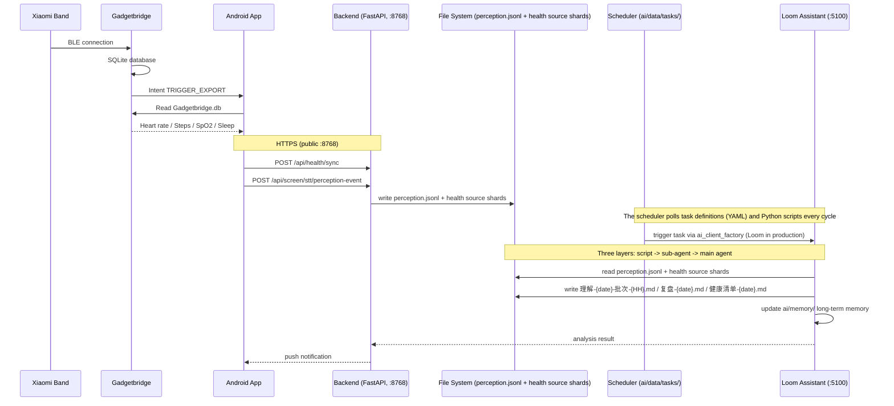

# Kinship

**English** | [中文（默认）](README.md)

A self-hosted AI personal data assistant. An Android app continuously collects sensor data from your phone and smart band (heart rate, steps, GPS, ambient audio, notifications, screen state, and more), uploads it to your private backend, where Loom periodically analyzes everything and generates insight reports.

This is not just another health tracker. It is a **continuously running AI agent that learns about you**: your daily rhythms, your behavioral patterns, your anomalies. At the end of each day, it tells you how your day went. All running on your own server.

**Use cases**: personal life data archiving, AI daily/weekly reports, behavioral pattern analysis, anomaly detection and alerting.

> **Project status**: Early stage. The author is busy with studies, but the system runs daily and is stable. There may be legacy issues and compatibility gaps. Tested on Windows and Linux (production has migrated to Linux); macOS may work but is untested. The frontend (Vue SPA) lives in `frontend/mobile/` (sub-agent nesting, token usage display, etc.).
>
> **On AI capabilities**: Do not expect the AI to truly understand you. Audio processing is limited. Do not rely on the imperfect ASR and speaker recognition to accurately determine your context and activities. Speaker recognition is especially rough at first (early voiceprints are noisy), but it improves noticeably once the cohort model is established. The system cannot perceive stretching, yawning, mental state, emotions, or other subtle details of daily life. That said, the system is still useful. With enough accumulated data, the AI can analyze your behavioral habits, movement patterns, communication style, and tendencies.

## Why Kinship

Kinship is not another health tracker, and it is not a chat bot with health data bolted on. It is a self-hosted, continuously running personal life agent: phone, band, PC, and audio signals form an inspectable life stream, and an AI backend reviews that stream on a schedule.

What makes it different:

- It starts from a life stream, not a chat thread.
- The interface is the filesystem: JSONL, Markdown, and daily shards, not an opaque data store.
- Audio algorithms run in an isolated kernel; the business backend stays free of ML.
- The assistant has a rhythm: scheduled checks, daily reviews, weekly summaries, and wake-ups.
- The pipeline separates deterministic scripts, sub-agents, and the main agent.
- The whole stack is self-hosted, while the model backend remains replaceable.

Kinship is early-stage. Audio understanding is deliberately bounded, the kernel is closed source, and audio is unavailable without it. It is not a managed SaaS or a medical diagnostic system.

**One line:** Kinship is a self-hosted system that keeps your life data in your hands and lets an AI understand it on your own schedule.

## Repository layout

Kinship spans three locations, not one monorepo:

| Location | Contents | Distribution |
| --- | --- | --- |
| `kinship` (this repository) | Backend, Android app, frontend, desktop shell, Loom harness, docs, release assets | Public source tree |
| `kinship-kernel` | Closed-source audio kernel source (`axeuh_kernel`) | Private; PolyForm Noncommercial 1.0.0 |
| `kinship-data` | `config.yaml`, certificates, `backend/config/auth.json`, AI runtime data and uploads | Private; never committed |

The public tree excludes `ai/`, the `kernel/` source, `tools/moss-shadow/`, and the CircuitJS1 runtime. `ai/` is per-instance data created from `ai-template/`; the kernel is installed as a prebuilt release asset at `<project>/kernel`; `tools/moss-shadow/` is private; CircuitJS1 is fetched from the separate [kinship-circuitjs](https://github.com/Xehuri/kinship-circuitjs) repository at dev/build time.

At runtime the backend expects:

- `<project>/kernel`: the installed kernel package. No source checkout is needed. Kernel source is maintained in the private `kinship-kernel` repository.
- `data.ai_root`: the single AI root (default `<project>/ai`). It holds AI configuration, memory, and `data/`, and may point at a private `kinship-data` directory.
- A private data root for `config.yaml`, certificates, auth state, models, and runtime data outside git.

All kernel models, including ERes2NetV2, are downloaded by the `kernel_models` onboarding step. The kernel tarball contains no `models/` directory and no `.ckpt` files. The kernel API remains 1.0.0.

---

## Architecture

```mermaid
graph TB
    subgraph DataSources[Data Sources]
        BAND[Xiaomi Band] -->|BLE| GB[Gadgetbridge<br/>SQLite DB]
        PHONE[Phone Sensors<br/>GPS / Mic / Screen / Notifications]
        PC[Windows PC Sensor<br/>Idle state / Foreground window]
    end

    subgraph AppCollect[Android App - Collection Layer]
        HDC[HealthDataCollector<br/>Reads Gadgetbridge DB]
        SENSORS[AudioCollector / GpsCollector<br/>SystemStateCollector / NotificationCollector]
        UPLOAD[AppHttpClient<br/>HTTPS Upload]
    end

    subgraph Backend[Backend - FastAPI]
        AUTH[AuthMiddleware<br/>Token Auth]
        PORTS["Port :8768 (public, frpc 8768 to 8768)<br/>HTTP/HTTPS share 8768; ssl.enabled decides"]
        HEALTH["/api/health/*<br/>Health data sync / query"]
        PERCEPTION["/api/screen/stt/*<br/>Perception ingestion (phone)<br/>/api/pc/* (PC sensor)"]
        SCREEN["/api/screen/*<br/>TTS / Session / Model / SSE"]
        STORE["File System Interface<br/>perception.jsonl (single write)<br/>health source shards (users/{user}/health/{date}/)<br/>daily health.json: history-only derived view"]
        SCHED[Task Scheduler<br/>polls ai/data/tasks/ (YAML + Python)]
        CLIENT[AI Client<br/>ai_client_factory]
        KERNELC[Kernel Clients<br/>kernel_client / kernel_job_client / segment_channel]
    end

    subgraph AudioKernel[Audio Kernel - closed source]
        KERNEL["axeuh_kernel<br/>127.0.0.1:dynamic port<br/>spawned by the backend<br/>ASR / VAD / voiceprint / KWS / scene / diarization / unknown speakers"]
    end

    subgraph FrontendWeb[Frontend]
        MOBILE["Vue 3 SPA /mobile/"]
        VAUDIT["Voiceprint audit /vaudit/"]
        PREVIEW["Preview console /preview/"]
    end

    subgraph AISystem[AI Assistant - Loom 127.0.0.1:5100]
        SCRIPT[Script Layer<br/>preprocess + coverage check]
        SUBAGENT[Sub-Agent Layer<br/>data-check / review]
        MAINAGENT[Main Agent Layer<br/>orchestrate / verify / self-optimize]
        MEM["ai/memory/<br/>long-term memory"]
        NOTIFY[Push Notification]
    end

    GB -->|Read SQLite| HDC
    PHONE --> SENSORS
    PC -->|HTTP POST /api/pc/sync| PERCEPTION

    HDC --> UPLOAD
    SENSORS --> UPLOAD

    UPLOAD <-->|Upload / Query| HEALTH
    UPLOAD -->|Upload| PERCEPTION
    UPLOAD <-->|TTS / Session / SSE| SCREEN

    HEALTH --> STORE
    PERCEPTION --> STORE
    STORE -.->|perception.jsonl + health source shards| SCRIPT
    SCHED -->|triggers tasks| CLIENT
    CLIENT <-->|127.0.0.1:5100| MAINAGENT

    PERCEPTION -->|audio analysis| KERNELC
    KERNELC <-->|"HTTP + WS 127.0.0.1"| KERNEL

    SCRIPT --> SUBAGENT
    SUBAGENT --> MAINAGENT
    MAINAGENT --> MEM
    MAINAGENT -->|writes reports| STORE
    MAINAGENT --> NOTIFY
    NOTIFY -->|Push| UPLOAD

    MOBILE -.-> PORTS
    VAUDIT -.-> PORTS
    PREVIEW -.-> PORTS
```

### Ports and Processes

| Process | Bind | Notes |
| ------- | ---- | ----- |
| Backend | `8768` | Public entry point (frpc maps the public `8768` to local `8768`); a single port serves HTTP and HTTPS (`ssl.enabled` decides the protocol); the Android app and the web UI connect here |
| Loom assistant host | `127.0.0.1:5100` | Production assistant; a child of `axeuh-health` in this deployment (standalone `axeuh-loom.service` is disabled/optional) |
| PC Sensor | `127.0.0.1:18888` | Local HTTP state collector (`desktop/pc-sensor/`); pushes idle/locked/foreground state to `/api/pc/sync` |
| Local LLM (vLLM) | `127.0.0.1:8000` | Optional local model server (Qwen3.8-27B GPTQ-W4A16, TP=2); not required by the backend |
| MOSS serve (vLLM) | `127.0.0.1:8100` | MOSS-Audio-4B fp8 on GPU 2 (3060 Ti); formalization in progress (seven steps done, 2-day regression + 7-day observation pending); loopback + `--max-num-seqs 1`; systemd `axeuh-moss` |
| Audio console | `127.0.0.1:8790` | `tools/audio-console/` listening library and human-baseline annotation workbench |
| QQ gateway IPC | `127.0.0.1:8770` | Bearer-token HTTP action surface for the `qq` CLI (`ai/skills/qq-cli/`); qq-mcp is retired; the gateway itself is off by default (enabled in this deployment) |
| Audio Kernel | `127.0.0.1:<dynamic>` | Closed-source audio algorithm process installed at `<project>/kernel` (source is private; API 1.0.0). Spawned on demand by the backend (`python -m axeuh_kernel --port 0`, loopback bind, ephemeral port reported on the handshake line and reused via a pidfile); it performs all ASR / VAD / voiceprint / KWS / scene / diarization / unknown-speaker computation. Contract: [docs/kernel-contract.md](docs/kernel-contract.md) |

> **Production topology (this deployment):** Loom at `127.0.0.1:5100` is the assistant host. It runs as a child of the backend service; the standalone `axeuh-loom.service` is disabled and kept only for rollback. The MOSS sidecar and the QQ gateway are auxiliary services and do not change this assistant path.

### Data Flow



### How the AI Works

- **Collection.** The Android app reads Gadgetbridge's SQLite DB and its own sensors (GPS, microphone, screen state, notifications), then uploads over HTTPS. The optional PC sensor pushes PC state (idle, locked, foreground window) over HTTP (`POST /api/pc/sync`).
- **Storage.** Perception events are single-written to `ai/data/daily/{date}/perception.jsonl`; health uploads go to per-source daily shards under `ai/data/users/{user}/health/{date}/`. The old `daily/{date}/health.json` derived view and the notification sidecar store are retired as write targets (history-only); the data directory remains the only interface between the collection side and the AI side.
- **Scheduling.** Loom's master + WakeQueue + PlanScheduler has owned the fixed-time Loom schedule since 2026-10-28 06:45; the old fixed-time YAML tasks and `data_check_scheduler.py` are disabled but retained for rollback. The backend TaskScheduler still manages remaining scripts and event-driven watchers; the legacy assistant gateway was retired with 1.5.3 (the QQ gateway is a separate, optional integration).
- **AI workflow (three layers).** The script layer preprocesses raw data and verifies coverage, the sub-agent layer writes understanding records and reviews, and the main agent layer orchestrates, verifies, and self-optimizes.
- **Outputs.** `理解-{date}-批次-{HH}.md`, `复盘-{date}.md`, and `健康清单-{date}.md` under `ai/data/`; long-term memory under `ai/memory/`; results pushed to the phone as notifications.

See [docs/dev/AI_SYSTEM.md](docs/dev/AI_SYSTEM.md) for the full AI system architecture.

---

## Quick Start

See [docs/ops/STARTUP.md](docs/ops/STARTUP.md) for the full platform matrix, exit codes, and troubleshooting. The backend entry point is `python -m core.hot_server`, run from `backend/`; the platform scripts wrap that command.

1. **Clone the repository.**
2. **Run the setup script for your platform.** Linux and macOS use `./scripts/setup.sh`; Windows uses `setup.bat`. It creates `.venv`, installs backend dependencies, and generates `config.yaml` from `config.example.yaml` and `ai/` from `ai-template/` when missing. Existing files are not overwritten.
3. **Review `config.yaml`.** Check server, SSL, model, and API keys against [docs/ops/CONFIGURATION.md](docs/ops/CONFIGURATION.md).
4. **Start the backend.** Linux and macOS use `./scripts/start.sh`; Windows uses `start.bat`. Production runs under systemd with `deploy/kinship.service.example`.
5. **Open the web UI.** Complete admin registration and the 11-step onboarding: account, dependencies, kernel, models, Xiaomi cloud, QQ, MOSS, Loom, clients, finish.
6. **Verify health.** `http://127.0.0.1:8768/health` should return `{"status":"healthy"}`.
7. **Set up clients.** Install the Android app with Gadgetbridge; the PC sensor is optional. See [docs/ops/INSTALL.md](docs/ops/INSTALL.md).
8. **Run the AI system initialization.** Walk through `ai-template/系统初始化指南.md`: scan the directory, get to know the user, register voiceprints, confirm data is flowing, then discuss tasks.

## Startup

**Linux / macOS**

```bash
cd kinship
chmod +x scripts/setup.sh scripts/start.sh
./scripts/setup.sh
./scripts/start.sh
```

**Windows**

```bat
setup.bat
start.bat
```

**Linux production (systemd)**

```bash
sudo cp deploy/kinship.service.example /etc/systemd/system/kinship.service
sudo systemctl daemon-reload
sudo systemctl enable --now kinship
```

The example unit uses placeholder paths, users, and interpreter paths. Adjust it for your deployment; do not copy the author's private production unit.

The scripts do not build the frontend and do not install or build the audio kernel. If `frontend/dist` is missing, onboarding downloads the released frontend; a manual build is dev-only and needs the separate CircuitJS repository. Audio requires the external kernel; without it the backend still starts but audio is unavailable.

## AI System

The AI subsystem is required, not optional. Production uses **Loom** at `127.0.0.1:5100`, running as a child of the backend service (`ai_backend: loom`); the standalone `axeuh-loom.service` is disabled and kept only for rollback. See [docs/dev/AI_SYSTEM.md](docs/dev/AI_SYSTEM.md) for the full architecture.

- **Three-layer workflow.** Script layer (`ai/analysis/fact_extractor.py`, `check_coverage.py`) -> sub-agent layer (`data_checker` / `reviewer`, prompts in `ai/agents/`) -> main agent layer (dispatch, verify, self-optimize).
- **Scheduling.** Since 2026-10-28 06:45 the Loom master (`ai/data/plan/master.json`) + daily overlay + WakeQueue + PlanScheduler drive fixed-time work: coverage at 00:00 / 06:00 / 08:00 / 12:00 / 16:00 / 20:00 / 22:00; daily review at 00:40; weather at 07:00; compactor at 04:00; weekly summary Monday 03:00; bi-weekly review on the 1st and 15th at 18:30. The 05:00 plan and 07:30 review anchors run through `axeuh-loom-plan.timer` / `axeuh-loom-review.timer`; old fixed-time YAML tasks are disabled for rollback. MOSS/systemd and event-driven watchers stay external.
- **Memory (A scheme).** The main session loads 6 resident files (~36.5 KB, down from ~190 KB); data-check/review roles receive 5 core files. `memory_write.py` / `memory_retrieve.py` / `memory_audit.py` / `memory_consolidate.py` handle writes, auxiliary retrieval (`grep` + `read` is primary), audits, and cleanup. Daily summary <=24 KB, batch index <=4 KB.
- **MOSS sidecar (formalization in progress).** `tools/moss-shadow/` runs `axeuh-moss` (MOSS-Audio-4B fp8 on GPU 2 / 3060 Ti at `127.0.0.1:8100`, loopback, `--max-num-seqs 1`) and `axeuh-moss-watch`, writing `audio_deepdive.jsonl`; seven steps are done, with 2-day regression + 7-day observation pending. `fact_extractor` consumes only `silence`/`ambient` MOSS sublines; human/mixed/device rows remain audit-only. `perception.jsonl` and the main chain are untouched.
- **QQ gateway.** Optional single-WS gateway to NapCat with a SQLite inbox/outbox; IPC at `127.0.0.1:8770` for the `qq` CLI; qq-mcp is retired; `qq_gateway.enabled` defaults to `false` (enabled in this deployment).
- **Loom features.** Interactive PTY (`pty_*`), converge auto-wake, simplified converge receipts, and ops+chat dual-perspective compaction.

Optional voice wake word and PC sensor are covered in [`docs/ops/INSTALL.md`](docs/ops/INSTALL.md). The full AI architecture, automation details, memory rules, MOSS/QQ behavior, and design principles live in [`docs/dev/AI_SYSTEM.md`](docs/dev/AI_SYSTEM.md).

## Windows Desktop App

`desktop/` is an Electron 45 shell for the existing web SPA. It opens `${server}/mobile/` in a native window, stores the server origin locally, and bundles the PC sensor as a supervised child process, so one app and one tray icon cover both the web UI and PC state collection.

Server address and certificate trust are configured on first run in the local setup page. A valid public certificate works as-is; a self-signed certificate requires explicit leaf pinning after the fingerprint is reviewed. The PC sensor can authenticate with an account or a backend token.

Build artifacts are `Kinship-Desktop-Setup-<version>-x64.exe`, `Kinship-Desktop-Portable-<version>-x64.exe`, and `Kinship-Desktop-<version>-x64.zip`. Build with:

```bash
cd desktop && npm ci && npm run stage:pc-sensor && npm run build && npm run dist:win
```

> Upgrading from a pre-rebrand build (`Axeuh-Health-Desktop-*`) leaves the old `%LOCALAPPDATA%\Programs\Axeuh Health Desktop` directory and its uninstall entry behind. Run [`desktop/scripts/cleanup-legacy-install.ps1`](desktop/scripts/cleanup-legacy-install.ps1) or uninstall the old version manually. User data in `%APPDATA%\Axeuh Health Desktop` is kept and reused by the new app.

See [desktop/README.md](desktop/README.md) for architecture, first-run setup, TLS trust, PC sensor behavior, Wine builds, and verification.

## Documentation

| Document | Contents |
| -------- | -------- |
| [docs/README.md](docs/README.md) | Public documentation index |
| [docs/ops/STARTUP.md](docs/ops/STARTUP.md) | Platform startup scripts, systemd example, first-run onboarding |
| [docs/ops/INSTALL.md](docs/ops/INSTALL.md) | Install phases 1-5, AI working directory, wake word, PC sensor, prerequisites |
| [desktop/README.md](desktop/README.md) | Windows desktop app: architecture, first-run setup, PC sensor, TLS trust, build, verification |
| [docs/ops/CONFIGURATION.md](docs/ops/CONFIGURATION.md) | Full `config.yaml` reference |
| [docs/dev/API.md](docs/dev/API.md) | API endpoint table |
| [docs/dev/PROJECT_MAP.md](docs/dev/PROJECT_MAP.md) | Directory structure and subsystem map |
| [docs/dev/AUDIO_PIPELINE.md](docs/dev/AUDIO_PIPELINE.md) | Ambient audio upload, seamless stream, FLAC/WAV |
| [docs/dev/AI_SYSTEM.md](docs/dev/AI_SYSTEM.md) | AI architecture: Loom, tasks, memory, MOSS, QQ |
| [docs/dev/DATA_FORMAT.md](docs/dev/DATA_FORMAT.md) | Perception and health data format |
| [docs/kernel-contract.md](docs/kernel-contract.md) | Closed-source audio kernel contract |
| [docs/kernel/README.md](docs/kernel/README.md) | Kernel distribution, models, runtime path, and licenses |

## Deployment Notes

Real-world deployment pitfalls (missing `dist/`, frp/nginx/cert traps, plus kernel-side notes such as the gated pyannote VAD model and `cu128` wheels for RTX 50 GPUs) are collected in the repository's deployment guide (Chinese, private).

---

## FAQ

**Q: There is no default username or password / how do I create the admin account?**

A: On first launch the system has no user. Open the web UI and complete the setup screen to choose your admin username and password (at least 6 characters). A one-time bootstrap token is required by default (anti-takeover): read it from `backend/config/.setup_token` (or the `AXEUH_AUTH_STATE_DIR` location) and send it as `X-Setup-Token`. Set `auth.setup_require_token: false` only for a trusted private network. Credentials are stored in `backend/config/auth.json`; nothing is read from `config.yaml`.

**Q: Android App cannot connect to the server**

A: Check:

1. The server firewall is open for the configured port
2. Use `openssl s_client -connect <IP>:<PORT>` to verify the certificate
3. The URL in the app must start with `https://`
4. The phone and server are on the same network (LAN), or the server has a public IP

**Q: Band keeps disconnecting**

A: Two apps are fighting for the BLE connection. See `docs/ops/INSTALL.md` (Phase 5.6).

**Q: Health data shows nothing**

A: Check:

1. Gadgetbridge is paired with the band and syncing data normally
2. The band database path in the app settings is correct (default: `/storage/emulated/0/Gadgetbridge.db`)
3. Tap "Sync data now" and wait 10 seconds, then check the data status again
4. Auto-export is enabled in Gadgetbridge

**Q: Frontend page shows 404**

A: The `frontend/mobile/dist/` directory is missing. On startup the backend logs the warning and tries to download the released frontend in the background; watch the log for progress and checksum results. If the download fails, run `npm run build` in `frontend/mobile/` or copy a prebuilt `dist/` into place.

**Q: Background Service keeps getting killed**

A: Xiaomi, OPPO, Huawei and other OEMs aggressively restrict background processes. You must:

1. Lock the app in recent tasks (pull down on the card)
2. Settings -> Battery optimization -> Unrestricted
3. Enable auto-start
4. On some systems, also add the app to "Protected apps" in the security center

---

## License

The repository uses component licenses:

- Repository root, including backend, AI, tools, and other files not listed below: [AGPL-3.0-only](LICENSE)
- Loom: [AGPL-3.0-only](loom-harness/LICENSE)
- Frontend, Android app, and desktop: [Apache-2.0](frontend/mobile/LICENSE)
- Audio kernel: [PolyForm Noncommercial 1.0.0](docs/kernel/LICENSE). Commercial use requires a separate agreement; see [docs/kernel/COMMERCIAL.md](docs/kernel/COMMERCIAL.md). Distribution terms: [docs/kernel/EULA.md](docs/kernel/EULA.md)
- CircuitJS1: GPL-2.0, distributed from the independent [kinship-circuitjs](https://github.com/Xehuri/kinship-circuitjs) plugin and fetched at dev/build time (not vendored here)

Third-party components and their notices are listed in [THIRD_PARTY_NOTICES.md](THIRD_PARTY_NOTICES.md).

Copyright 2026 Xehuri.

## Contributing

Contributions are welcome. See [CONTRIBUTING.md](CONTRIBUTING.md) for how to get involved.
