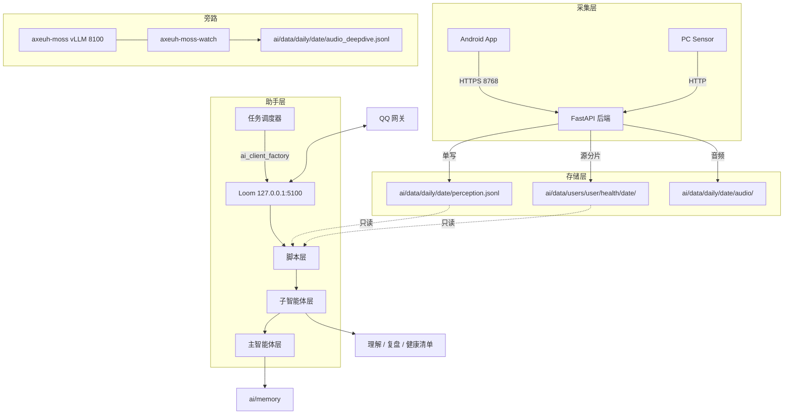

# Kinship AI 系统（Loom 现行版）

> 状态：现行（2026-10-22 重写）。生产助手宿主 Loom 127.0.0.1:5100。

---
- [1. 架构概览](#1-架构概览)
- [2. 助手宿主：Loom](#2-助手宿主loom)
- [3. 三层工作流](#3-三层工作流)
- [4. AI 目录结构](#4-ai-目录结构)
- [5. 任务调度](#5-任务调度)
- [6. 子智能体](#6-子智能体)
- [7. 分析脚本](#7-分析脚本)
- [8. 数据接口与数据流](#8-数据接口与数据流)
- [9. 记忆系统（A 方案）](#9-记忆系统a-方案)
- [10. MOSS 深度音频影子管线](#10-moss-深度音频影子管线)
- [11. QQ 网关](#11-qq-网关)
- [12. 核心设计原则与边界](#12-核心设计原则与边界)

---
## 1. 架构概览



AI 不采集数据，也不参与采集实现。后端负责接收、存储、调度与内核编排；AI 只读已落盘文件，把结论写回 `ai/`。两侧以文件系统为接口，换掉任意一侧不影响另一侧。

| 进程 | 绑定 | 说明 |
|---|---|---|
| 后端（HTTP 与 HTTPS 同端口） | `8768` | 对外入口与本地开发；`ssl.enabled` 决定协议 |
| Loom 助手 | `127.0.0.1:5100` | 生产唯一助手宿主，systemd `axeuh-loom` |
| 音频内核 | `127.0.0.1:<动态>` | 闭源 `axeuh_kernel`，后端按需 spawn，端口写入 pidfile |
| MOSS serve | `127.0.0.1:8100` | vLLM，卡2 3060 Ti，fp8；转正执行中，loopback + `--max-num-seqs 1` |
| QQ 网关 IPC | `127.0.0.1:8770` | HTTP + Bearer token，供 qq CLI 调用 |

核心约束：后端运行时零 ML、零算法实现；音频算法全部在闭源内核。内核只监听 loopback、只做本地计算，接收音频并返回结果，不上传任何数据到外部服务（包括音频和用户数据）；音频由 App 上传，后端负责接收、落盘与业务写入，内核的本地状态只在 `--state-dir` 下（数据边界见 [kernel/README.md](../kernel/README.md#data-boundary)）。MOSS 转正执行中、QQ 网关是可选旁路，故障不改变 `perception.jsonl` 与主分析链。数据文件是契约，分析结论必须可回溯到文件与时间。

---
## 2. 助手宿主：Loom

Loom 是公开模板默认的助手宿主，固定为 `127.0.0.1:5100`，由 systemd `axeuh-loom` 管理；初始化引导（onboarding）写入 `ai/.loom/config.yaml`，会话与状态保存在 `ai/.loom/`。后端经 `services/ai_client_factory.py` 的 `acquire_ai_client()` 获取 Loom 客户端，任务、QQ 与通知统一投递到该宿主。

### Loom 运行时能力

| 能力 | 现行行为 |
|---|---|
| 交互式 PTY | `pty_spawn` / `pty_write` / `pty_read` / `pty_list` / `pty_kill`；`notifyOnExit` 默认 true，退出经 `deliverWake` 投回发起会话：空闲立即起唤醒轮，忙则当前轮收尾后起新轮 |
| 自动唤醒 | 主会话 `converge` 可带 `wake`（倒计时、带时区 ISO、本地 `HH:MM`、`none`）；到点经 `deliverWake` 投 `【自动唤醒】` durable user 消息并起轮 |
| 唤醒持久化 | sidecar `ai/.loom/state/session/wake/{sid}.json`，耐重启；侧会话/子智能体不可用 |
| converge 回执 | 主会话只需 `status`，digest 自动派生，body 可省略；侧会话 digest 内部派生 |
| 上下文压缩 | 2026-10-21 起生产 worker `summaryMode: auto`；2026-10-22 起默认 ops+chat 双视角合成一条摘要注入，`summaryPerspectives: ["ops"]` 可回退 |

长任务、构建、下载、REPL 一律用 `pty_spawn` 并设 `notifyOnExit=true`，收到 `<pty_exited>` 再继续；不要用 `nohup ... & sleep N` 或前台 `sleep` 等待。`pty_write` 用 `\x03` 中断，输出用 `pty_read` 分页或正则读取。

---
## 3. 三层工作流

AI 处理任何数据都遵循“脚本层 → 子智能体层 → 主智能体层”：

- **脚本层**：`fact_extractor.py` 把原始 JSON 转成可读事实文件；`check_coverage.py` 验证时间线覆盖；记忆工具做体检与巩固。只做机械活，不做语义分析。
- **子智能体层**：`data_checker` / `reviewer` / `05-audit` 按各自 prompt 做专业分析，写理解记录、复盘、周报与审计产物。不做跨域决策，不直接回复用户。
- **主智能体层**：理解意图、派发任务、验收产物、处理异常、自优化。L2 分析不亲自下场，只读脚本与子智能体的结论。

### 数据检查批次流程

1. `data_check_scheduler.py` 到点生成带日期与窗口的 prompt，经 `trigger_task` 投给主会话。
2. 主会话运行 `python ai/analysis/fact_extractor.py {date} --hours {start}~{end}`，把原始感知合并进 `事实-全天.md`。
3. 主会话派 `data_checker`（或 `01_data_check`）子智能体，按 `ai/agents/01-data-check.md` 逐段写 `理解-{date}-批次-{HH}.md`。
4. 运行 `python ai/analysis/check_coverage.py {date}` 复核覆盖；未过则回补缺口。
5. 子智能体在收尾写执行日志、在 git commit body 写 `## 任务概要`，主会话读完整 body 验收。

### 每日复盘流程

00:40 的 `12-daily-review.yaml` 先跑 `check_coverage.py` 验证昨天数据完整，再把昨天交给 `reviewer` 执行 `ai/agents/02-daily-review.md`：读取当天全部批次理解文件，做跨日对比、异常检测与记忆收割，写 `复盘-{date}.md`，更新 `fact/{月}.md` 与执行日志后提交；主会话验收文件存在与 commit 概要。

分析产出类任务（01 批次分析、02/03/04 复盘）必须独立完成，禁止嵌套孙代理；待办、调研、信息收集类任务可以派孙代理辅助，委托型业务由批次按 01 步骤 8 自行派发。

---
## 4. AI 目录结构

```text
ai/
├── AGENTS.md                 # 一级记忆：不变的系统规定与导航
├── agents/                   # 子智能体 prompt + 规则库
│   ├── main.md               # 主会话身份声明（人格/模式/边界）
│   ├── 01-data-check.md ~ 04-weekly-review.md
│   ├── 05-audit.md           # 夜间审计
│   ├── 复盘-公共.md           # 02/03/04 共享流程
│   ├── 规则-01-data-check.md # 数据检查规则库
│   └── data-checker.md / reviewer.md  # 薄壳定义
├── analysis/                 # Python 分析脚本（含记忆工具）
├── data/
│   ├── daily/{date}/         # 感知、音频、事实、理解、复盘、摘要
│   ├── users/{user}/health/{date}/  # 健康源分片 phone.json/cloud.json
│   ├── tasks/                # 定时任务 YAML + 常驻 Python 脚本
│   └── cache/                # 运行时缓存
├── memory/                   # 长期记忆（self / profile / fact / topics）
├── .loom/                    # Loom 配置、会话与运行状态
└── skills/                   # Loom 技能（如 loom-handover）
```

| 文件 | 角色 | 谁写 | 谁读 |
|---|---|---|---|
| `daily/{date}/perception.jsonl` | 原始感知数据，单写入口 | 后端追加 | AI 只读 |
| `daily/{date}/audio/` | 环境音频分片 | 后端 | `fact_extractor`、MOSS watcher |
| `daily/{date}/audio_deepdive.jsonl` | MOSS 旁路深读结果 | watcher | `fact_extractor`（只读） |
| `users/{user}/health/{date}/{phone,cloud}.json` | 健康真源分片 | 后端 `HealthStore` | AI 经 `read_view` 读取 |
| `daily/{date}/health.json` | 历史派生视图 | 仅迁移/历史存量 | 只读兼容 |
| `daily/{date}/事实-全天.md` | 脚本生成的数据摘要 | `fact_extractor.py` | 子智能体 |
| `daily/{date}/理解-{date}-批次-{HH}.md` | 逐批理解记录 | 数据检查子智能体 | 复盘/周报/双周 |
| `daily/{date}/复盘-{date}.md` | 复盘报告 | 复盘子智能体 | 用户/周报 |
| `daily/{date}/当日摘要-{date}.md` | ≤24KB 的当日摘要 | `fact_extractor --update-summary` | 主会话/复盘 |
| `daily/{date}/批次索引-{date}.md` | 每批一行，≤4KB | `fact_extractor --update-summary` | 主会话/复盘 |
| `tasks/*.yaml` / `tasks/*.py` | 任务定义 | 用户/AI | 后端调度器 |

---
## 5. 任务调度

Loom 调度已于 2026-10-28 06:45 切到 master + WakeQueue + PlanScheduler 的 live 路径。旧固定时刻 YAML 与 `data_check_scheduler.py` 已停用但保留回滚；事件驱动 watcher、MOSS systemd 和常驻脚本仍在外部。完整契约与执行记录保留在私有运维文档。

Loom 同时按单主会话运行（2026-10-28）：`GET /sessions/main` 是唯一主会话查询面，返回单个对象；`GET /sessions` 默认 404 `session_list_disabled`，仅 `server.sessionList: true` 开放。主会话优先级为 `server.mainSessionId` > 标记 `{stateRoot}/session/main-session.json` > `scheduling.sessionId` > 首个持久化会话 > 新生成。后端 Web 绑定写 `loom:main-task`，裸 `main-task` 留给语音/QQ；部署与回滚见 [OPERATIONS.md](../ops/OPERATIONS.md)。

| 路径 | 状态 | 排班真源 |
|---|---|---|
| Loom master + WakeQueue | live（2026-10-28 06:45） | `ai/data/plan/master.json` + 每日覆盖层 |
| 后端 TaskScheduler | 固定时点任务已停发；保留回滚 | `ai/data/tasks/*.yaml` 与常驻脚本 |

### Loom master 排班（live 已激活）

- master：`{planRoot}/plan/master.json`，版本化，包含固定时段、7 个 coverage 锚点与长期条目；`master.md` 是派生人读视图，`master.last-good.json` 供降级读取。模型不写 master，编辑只走 `loom plan master edit` 的 CAS。
- 每日覆盖层：`{planRoot}/daily/{date}/plan-{date}.overlay.json`，带 `base_version` 和 add/update/remove/note 四种 diff op。有效视图 = master 当日物化 + overlay 合并；旧 `plan-{date}.json` 只读回退。
- 工具面：`plan read/base/diff/revise/done/note/close`。`done` 只写覆盖层与 `plan-ledger.jsonl`，主会话拥有完成状态，调度器不推断完成。工具输出为紧凑纯文本（2026-10-28 起，plan/long_task/搜索/task_fetch 均不再回灌 JSON），结构化数据留在 `details`；`read`/`base` 默认隐藏任务 `instruction` 正文，`include_instruction: true | ["id"]` 按需展开；`leftovers` 只保留昨日 `planned/blocked/carried` 且不在当日计划中的条目。`diff`/`revise` 支持 `user_intent`（只记录，不参与 coverage）；`read`/`base` 支持 `status`/`kind` 过滤（`anchor` 别名）；新增或改写 care 的 `done_when` 必须非空且含 `HH:MM` 或配非空 `window`，否则改用 `kind=note`。
- WakeQueue：`{stateRoot}/session/wake-queue/{sid}.json`，plan/flow/special 多条目共存，每会话一条最早定时器；投递失败重试一次（+30 秒），随后归档 failed 并走死信；启动时恢复并迁移旧单槽唤醒。
- PlanScheduler：boot、05:00、07:30、看门狗与 `POST /plan/reconcile` 触发确定性对账；默认 48 小时视野、8 小时追赶、8 到 24 小时迟到补做、超过 24 小时记欠账。shadow 只写 `{stateRoot}/plan/shadow/{date}.jsonl`，不投递。
- 锚点：`ai/analysis/plan_anchor.py` 先调用 `POST /plan/reconcile`，失败才回退旧唤醒消息；`axeuh-loom-plan.timer`（05:00）与 `axeuh-loom-review.timer`（07:30）已安装并 enabled。`GET /plan/state` 只读当前队列、版本与账本尾。
- 主会话与调度：主会话为 `ses_6320...`（历史转录，已 unarchive），config 不写 `mainSessionId`/`sessionId`，由 marker 固定并由调度回落；`loom_main` 仍 archive，旧队列退休。
- 07:00 天气已由 live 路径投递；07:30 复核由 review timer + PlanScheduler 触发。旧 05/07 YAML、12/13/14/16 与 `data_check_scheduler.py`/`session_compactor.py` 已 `enabled: false`。

固定时刻的 Loom 任务由 master 接管，包括 7 个 coverage、00:40 复盘、02:00 夜间审计、周一 03:00 周报、04:00 压缩与探针、07:00 天气、08:30 fleet、每月 1/15 18:30 双周，以及 05:00/07:30 计划锚。MOSS systemd 单元、事件驱动 watcher 与常驻脚本继续留在外部，不进入 master；旧 YAML 停发但文件保留回滚。

### 旧 TaskScheduler（T15 后停发，保留回滚）

任务定义放在 `ai/data/tasks/`，后端调度器轮询目录并在到点时把 prompt 投递到主会话；YAML 与常驻 Python 脚本共用同一目录，保存后热加载。任务正文首行带场景前缀，例如 `【定时任务】{任务名}`、`【脚本任务】{脚本名}`。

```yaml
name: 示例任务
schedule:
  daily: "08:00"
enabled: true
prompt: |-
  按流程执行：先跑脚本，再派子智能体，最后验收并提交。
```

支持 `daily: "08:00"`、`hourly: 30`、`weekly: {days: "mon", at: "03:00"}`、`monthly: {1: "18:30", 15: "18:30"}`、`delay: "5m"`。

### 数据检查窗口（7 个）

由常驻脚本 `data_check_scheduler.py` 驱动，状态写入 `.data_check_state.json`，重启后不重复触发。00 点窗口归属前一天。

| 触发 | 覆盖时段 |
|---|---|
| 00:00 | 前一天 22:00~00:00 |
| 06:00 | 00:00~06:00 |
| 08:00 | 06:00~08:00 |
| 12:00 | 08:00~12:00 |
| 16:00 | 12:00~16:00 |
| 20:00 | 16:00~20:00 |
| 22:00 | 20:00~22:00 |

> T15 后这 7 个固定窗由 master 的 `coverage.run` 锚点接管；切换时必须停掉 `data_check_scheduler.py` 的旧窗提示，否则会双跑。

### 周期性任务

| 文件 | 触发 | 职责 |
|---|---|---|
| `12-daily-review.yaml` | 每天 00:40 | 完整复盘昨天 |
| `13-biweekly-review.yaml` | 每月 1/15 日 18:30 | 双周深度回顾 |
| `14-weekly-summary.yaml` | 每周一 03:00 | 周报总结 |
| `05-plan-wake.yaml` | 每天 05:00 | 日计划唤醒：Plan mode，只读 + `plan commit`，不执行 care，不发用户通知 |
| `07-plan-review.yaml` | 每天 07:30 | 计划复核：Plan mode，需要时 `plan revise`，不执行 care，不发用户通知 |
| `session_compactor.py` | 每天 04:00 | 提醒主会话整理信息；压缩与否由主会话判断，不自动调用压缩接口 |
| `15-night-audit.yaml` | 每天 02:00 | 夜间审计：`audit_collector.py` + `05-audit`；任务定义保留，当前 `enabled: false` |
| `16-weather-morning.yaml` | 每天 07:00 | 早间天气播报，按 `memory/self/tasks/天气播报.md` 执行 |

> `05-plan-wake.yaml` / `07-plan-review.yaml` 由后端 TaskScheduler 投递到 Loom 主会话；消息首行是 `【定时任务】{任务名}`，prompt 正文首行是 `【系统通知·日计划】` / `【系统通知·计划复核】`。模式规则见 `ai/AGENTS-operations.md`。
>
> T15 后上表固定时刻任务由 master 接管，05/07 两个 YAML 与其余固定任务文件保留为回滚件但停发；`session_compactor.py` 的 04:00 提醒由 master 的 `session.compact` 取代。

### 常驻 Python 脚本

`data_check_scheduler.py`（7 窗口）、`session_compactor.py`（04:00 提醒）、`17-wake-watch.py`（长息屏后首次真解锁唤醒，早晨附天气，3 小时节流/每天最多 6 次）、`18-night-checkin.py`（21:00 / 22:30 夜间主动找用户，当天去重）、`19-health-sync-watch.py`（每 5 分钟轮询 `cloud.json`，补上 ≥60 分钟空档时通知）、`foreground_watch.py`（按设备×应用统计连续前台亮屏时长）。`deepseek_balance_monitor.py`、`music_tracker.py`、`xiaomi_cloud_health.py` 当前 `enabled: false`。

脚本 frontmatter 至少包含 `name`、`enabled`，可选 `note`、`prompt`。运行时 `context` 提供 `log`、`trigger_task`、`alert`、`read_file`、`heartbeat`；自循环脚本必须每 300 秒至少调用一次 `heartbeat()`。沙箱做 AST 静态检查，禁止 `subprocess`、`threading`、`asyncio`、`importlib` 等导入，内存上限 256MB，`trigger_task` 限速 1 次/分钟。脚本异常写日志与审计，FileWatcher 负责热加载与故障重启。

事件驱动的常驻脚本（`17-wake-watch.py`、`18-night-checkin.py`、`19-health-sync-watch.py`、`foreground_watch.py`、`qq_private_relay.py`）与 MOSS systemd 单元继续留在外部，不进入 Loom master。

---
## 6. 子智能体

子智能体是独立 prompt 文件，主会话通过 `task` 工具的 `agent_type` 派发。可用类型以 Loom 面枚举为准：`general`、`explore`、`data_checker`、`reviewer`、`local_compare`、`01_data_check`、`02_daily_review`、`03_biweekly_review`、`04_weekly_review`、`05_audit`。

| 智能体 | 文件 | 职责 | 产物 |
|---|---|---|---|
| 数据检查 | `01-data-check.md` | 逐段读取事实文件，补充理解；步骤 7 发通知，步骤 8 挂载领域任务 | `理解-{date}-批次-{HH}.md` |
| 每日复盘 | `02-daily-review.md` | 步骤 0~7：加载上下文、读全部批次、跨日对比、异常检测、记忆收割、自检提交 | `复盘-{date}.md` |
| 双周回顾 | `03-biweekly-review.md` | 覆盖 10~14 天，找行为模式与“为什么” | 深度回顾报告 |
| 周报 | `04-weekly-review.md` | 覆盖一周，按时间线写叙事性周报 | 周总结 |
| 夜间审计 | `05-audit.md` | 机械采集 + 审计检查项，输出 PASS/FAIL/WARN/SKIP | `audit-{date}.txt` 与复盘审计小节 |
| 主会话 | `main.md` | 身份、模式、工具与边界声明 | 会话行为 |

`02/03/04` 共享 `复盘-公共.md` 的读 self、数据盘点、置信度、探索、执行日志、提交与通知流程；各自只保留节奏与模板差异。原 `05-feedback-agent` / `06-study-coach` 的职责已并入 01 步骤 7/8；小红书卡片任务已停用，不在现行 `agents/` 目录。`data-checker.md` / `reviewer.md` 是薄壳定义，实际流程在带编号的 role 文件中。

子智能体正常情况下每批独立新建会话；意外中断时复用原 `session_id` 重试并说明已完成内容，不要新建会话覆盖已有产物。仅当 session 完全不可用时才降级新建，并先备份已产出文件。

---
## 7. 分析脚本

### fact_extractor.py（核心）

把 `perception.jsonl` 转化为人类可读的 `事实-全天.md`，支持按时段合并、GPS 去重、心率范围化、语音去重、声纹信息保留与逆地理编码。

```bash
python ai/analysis/fact_extractor.py 2026-10-22
python ai/analysis/fact_extractor.py 2026-10-22 --hours 12:00~18:00
python ai/analysis/fact_extractor.py 2026-10-22 --update-summary
```

`--hours` 会输出该时段在事实文件中的行号范围，供子智能体精读；`--update-summary` 生成 `当日摘要-{date}.md`（v2，≤24KB，按 `##`/`#### 段N` 抽取）与 `批次索引-{date}.md`（每批一行，≤4KB），并更新健康清单。命中 `audio_deepdive.jsonl` 时，语音时间线行只追加 `静音/无语音` 或 `src=ambient` 的 `└ MOSS:` 子行；human/mixed/device 留审计。缺文件时输出逐字节不变。

### check_coverage.py（验收）

检查理解文件是否覆盖完整时间线，支持多批次文件合并后判断缺口。

```bash
python ai/analysis/check_coverage.py 2026-10-22
```

退出码：`0` 通过；`1` 漏时段（缺口 ≥2 小时）；`2` 数据不完整。正好 2 小时的缺口也算漏，避免边界漏报。

### 其他工具

| 脚本 | 用途 |
|---|---|
| `geocode_tool.py` / `sensor_coverage.py` / `all_coords.py` | GPS 逆地理编码、传感器覆盖、多日坐标汇总 |
| `health_extractor.py` / `health_source.py` | 健康摘要与分片读取 |
| `segment_generator.py` / `check_voiceprint.py` | 分段示例、声纹质量诊断 |
| `audit_collector.py` / `session_context.py` | 夜间审计采集、只读会话上下文与通知核对 |
| `query_chatlog.py` / `query_session_stats.py` | 历史对话与 token/花费查询 |
| `audio_mimo_analyzer.py` / `listen_audio.py` | MiMo 音频理解与试听 |
| `memory_audit.py` / `memory_write.py` / `memory_retrieve.py` / `memory_consolidate.py` | 记忆体检、写入、检索、巩固 |

`legacy/` 与 `mimo_batch_run*.py` 是实例专用实验残留，不属于通用工具。

---
## 8. 数据接口与数据流

| 路径 | 含义 | 写方 |
|---|---|---|
| `ai/data/daily/{date}/perception.jsonl` | 感知事件唯一入口（传感器、屏幕、通知、语音、PC 状态） | 后端 `append_perception` |
| `ai/data/daily/{date}/audio/` | 环境音频分片（WAV/FLAC） | 后端 `save_audio(origin="upload")` |
| `ai/data/stream/{date}/audio/` | 唤醒流音频，独立于增量数据 | 后端 `save_audio(origin="stream")` |
| `ai/data/users/{user}/health/{date}/phone.json` | 手机端健康源分片 | `HealthStore.write` |
| `ai/data/users/{user}/health/{date}/cloud.json` | 小米健康云源分片 | 云端拉取任务 |
| `ai/data/daily/{date}/health.json` | 历史派生兼容视图，2026-10-08 起停止新写 | 仅迁移/历史 |
| `ai/data/daily/{date}/audio_deepdive.jsonl` | MOSS 旁路深读，一行一 JSON | `axeuh-moss-watch` |

健康数据读取一律走 `HealthStore.read_view(user_id, date)`：cloud 先、phone 后，同时间戳后写覆盖；派生 `health.json` 只作为历史存量兼容。音频上传走无缝流：后端按 `device_id` 维护虚拟连续流，静音切分委托内核 WS `mode:"segment"`；唤醒流不写 `perception.jsonl`，`audio.stream.persist_perception` 仅为调试开关。

数据检查时序：调度器到点投 prompt → 主会话跑 `fact_extractor.py --hours` 得到事实文件与行号范围 → 派 `data_checker` 子智能体逐段写理解文件 → 跑 `check_coverage.py` 复核 → 子智能体写 commit body，主会话读完整 body 验收。

输出与消费：数据检查写 `理解-{date}-批次-{HH}.md`，每批独立，不覆盖已存在批次；复盘写 `复盘-{date}.md` 并更新 `fact/{月}.md` 的当日行与执行日志；周报/双周写 `ai/data/reports/`；健康清单由脚本生成，供复盘与主会话读取。运行数据不提交 git，只提交 `ai/` 文本产物与脚本变更。

---
## 9. 记忆系统（A 方案）

2026-10-20 起生产采用 A 方案：主会话少注入、批次按需检索、写入治理优先于检索扩张。

### 主会话常驻 6 件

`ai/agents/main.md` 声明：`AGENTS.md`、`memory/self/必读.md`、`memory/self/persona-lite.md`（身份+价值校准投影，02 刷新）、`memory/profile/state.md`、`memory/profile/core-lite.md`（core+semantic 投影，02 刷新）、`memory/topics/INDEX.md`。实测约 36.5KB，旧方案约 190KB（−80.8%）。`main.md` 另声明 `memory/self/chat-mode.md` 作为模式补充。

### 批次/复盘注入

四个 role 文件（`01-data-check.md`、`02-daily-review.md`、`03-biweekly-review.md`、`04-weekly-review.md`）通过 frontmatter 注入 5 件 core：`AGENTS-lite.md`、`必读.md`、`state.md`、`core-lite.md`、`topics/INDEX.md`；2026-10-20 起另机载 `memory/profile/规律-摘要.md`（规律层）。实际注入以 role frontmatter 为准。

### 记忆工具

| 工具 | 用途 |
|---|---|
| `ai/analysis/memory_audit.py` | 只读体检：常驻件数、role 注入、超线、tag、投影新鲜度、摘要/索引上限、孤儿 |
| `ai/analysis/memory_write.py` | 原子写与去重：append-log、append-scratch、upsert、mark、check、snapshot；目录锁 + temp + fsync + `os.replace` |
| `ai/analysis/memory_retrieve.py` | 只读检索：中文 2-gram + ASCII，按标题切段，`0.55 relevance + 0.30 recency + 0.15 importance`，按 UTF-8 字节预算截断 |
| `ai/analysis/memory_consolidate.py` | 离线巩固：daily 只清已标记 7 天 scratch；weekly 只报告重复/陈旧/超线/已完成任务 |
| `fact_extractor.py --update-summary` | 写当日摘要 v2（≤24KB）与批次索引（每批一行，≤4KB） |

`memory_retrieve.py` 仅辅助定位：2026-10-20 自拟 50 题基线 hit@12 35%、偏好 0/6、无答案 10/10 误召。自然语言、偏好、关系、日期优先用 `grep` + `read` 指定文件，命中后必须验证。检索升级不在本期范围。

### 写入与治理

- 每条知识只在一个地方定义；上层只放路径，细节不复制。
- 同 key 同文本写入为 NOOP；不同文本旧条目 `superseded` 并保留正文，不删除旧事实。
- 任务/状态类记忆只保留当前状态，完成即销；历史由 git 与 `daily/`、`fact/` 承担。
- 执行日志保留在 `ai/memory/self/执行日志/` 原位，不搬 `data/ledger`；归档只清已标记的 7 天 scratch 行，正文不做自动合并或删除。

### 记忆收割（每日复盘）

| 判定 | 去处 |
|---|---|
| 已确认稳定事实/属性 | `profile/semantic/people/`、`事项/`、属性四文件 |
| AI 推断待验证 | `self/认知.md` |
| 执行型待办 | `self/任务.md` |
| 用户纠正 AI | `self/纠错.md` |
| 用户认可的做法 | `self/价值校准.md` |
| 里程碑/承诺 | `self/关系.md` |
| 状态快照变化 | `profile/state.md` |
| 每日客观事件 | `fact/{月}.md` 当日行 |

只做增量检测，无增量零写入；复盘收尾必更新 fact 月度行与执行日志。

---
## 10. MOSS 深度音频影子管线

MOSS 转正执行中（2026-10-22 七步完成；待两日回归 + 七天观察）。`tools/moss-shadow/` 只是 CPU 侧编排；音频算法在闭源内核，MOSS 深度理解在独立 vLLM serve 中。v1 已冻结，v2/utterance 不接生产。

```text
daily/{date}/audio/*.wav|*.flac
  → 文件订阅（watcher）
  → 能量短路门（均值 < -50dBFS 且占比 <10% 直接写短路行）
  → N2 请求（POST http://127.0.0.1:8100/v1/chat/completions，原件 base64，guided JSON）
  → schema 校验（失败重试 1 次 → _error 行）
  → daily/{date}/audio_deepdive.jsonl（append-only）
```

| 单元 | 内容 |
|---|---|
| `axeuh-moss.service` | vLLM serve，`127.0.0.1:8100`（仅回环），卡2 3060 Ti，fp8，`max-model-len 3072`，`--max-num-seqs 1` 串行化 |
| `axeuh-moss-watch.service` | watcher，文件订阅 + 单线程顺序处理，默认 `--loop` |
| `axeuh-moss-regression.timer` | 每日 05:00 quick 18 窗（周日 full 34 段）；报告写 `tools/moss-shadow/state/regression/` |
| `axeuh-moss-alert.timer` | hourly 磁盘/日志/GPU/服务/质量告警；通知走后端 `/api/notification/send` |

产物 `audio_deepdive.jsonl` 一行一 JSON，主键 `audio` 指向 `daily/{date}/audio/{name}.{wav|flac}`，与 `voice` 行同址 join；成功行、短路行（`_sc:true`）、错误行（`_error`）三类。`merge.py` 生成 `audio_deepdive_merged.jsonl` 供门读数；`fact_extractor` 只读消费：事实文件只渲染 `静音/无语音` 或 `src=ambient` 的 `└ MOSS:` 子行；human/mixed/device/error 留在 deepdive 审计，不进入事实文件。

边界：对生产后端零依赖、零 import、零契约变更；watcher 或 serve 挂掉，生产照常运行。`perception.jsonl` 一字不改；`audio_deepdive.jsonl` 是独立旁路文件。已知盲区：无缝流中 `speech_ratio < 0.05` 的静音段在被分析前丢弃、不落盘，因此进不了 deepdive；静音钩子（未实施）才会覆盖这一层。七步已完成，待两日回归 + 七天观察；转正验收见 `docs/moss-formalization-plan-2026-10-22.md` §12。

---
## 11. QQ 网关

QQ 网关是可选入站/出站旁路，代码在 `backend/services/qq_gateway/`。Loom 不再挂载 qq-mcp，QQ 操作统一走 `qq` CLI（`ai/skills/qq-cli/`）；`backend/services/qq_mcp_server.py` 保留为 CLI 的实现库。

```text
QQ ←→ NapCat ←— 单条 forward WS —→ qq_gateway
                                   ├─ SQLite inbox/outbox/read-state/water-state
                                   ├─ 转发展开 / 渲染 / 媒体下载
                                   └─ 127.0.0.1:8770（HTTP + Bearer）← qq CLI（ai/skills/qq-cli）
```

- 对 NapCat 只保留一条 forward WS；CLI 不直连 NapCat，只经 `127.0.0.1:8770` 的 IPC 调 action 面。
- 默认关闭，`qq_gateway.enabled: true` 才启动；生产已启用。静态配置改动需重启后端（`get_config()` 为 `lru_cache`，不热加载）。
- 投递会话固定为 `main-task`；入站私聊按 `【QQ私聊】` 进入主会话，默认按 Chat 处理。群聊只发元数据提醒（`【QQ群聊·定向提醒】` / `【QQ群聊·自动提醒】`），不带正文；Loom 用 `qq history --unread --compact` 拉取后再决定回不回。
- 支持私聊/群聊入站白名单、@ 要求、shadow 计数、出站私聊/群聊开关、`dry_run`、转发消息递归展开、媒体下载与 GIF magic-byte 识别。
- 2026-10-24 起 qq-mcp 退役，23 个 QQ 操作由 `qq tools` 列出、`qq send` / `qq send-file` / `qq call <tool>` 覆盖；2026-10-24/25 新增共享未读水位（`/v1/read-state`）与水群模式（`/v1/water-state`：mentions/water/mute、评分提醒、60 秒/群冷却、TTL/空闲回落）。
- 未读历史中的图片/文件由网关 `/v1/media` 下载；`qq history --unread --compact` 在占位符后附本地绝对路径，Loom 可直接 `read`。
- 账号、白名单、WS 地址与 token 只写项目根 `config.yaml`（gitignored），不写入本文档。

回滚：`qq_gateway.enabled: false` → 重启后端。若要恢复 qq-mcp 面，恢复 `ai/.loom/config.yaml.bak-qqcli-<时间戳>` 并重启 Loom。

---
## 12. 核心设计原则与边界

### 分层决策

| 层级 | 做什么 | 不做什么 |
|---|---|---|
| 主智能体 | 协调、验收、决策、自优化 | 读原始数据逐条分析、写项目代码 |
| 子智能体 | 专业分析、写产物、研究取证 | 跨域决策、改项目代码 |
| 脚本 | 数据预处理、覆盖检查、记忆体检 | 语义分析、推理、决策 |

### 数据优先

每条分析结论必须有原始数据支撑；没有来源的分析视为无效。引用格式应能回到具体文件、时间与字段，而不是只给结论。

### 诚实标注

- 不确定就写“数据不足”，不编造。
- 每项判断标注置信度：确定/高/中/低/数据不足。
- 数据源有固有局限时说明，例如 GPS 后台抑制、ASR 误识别、健康分片缺失。
- 做不到的事直接说做不到。

### 反馈回路

- 任务完成、发现异常、需要确认时主动推送通知；疑问直接在通知中提出。
- 每日复盘包含自优化：检查脚本是否过时、子智能体 prompt 是否漏步骤。
- 代码/工具问题登记到 `self/任务.md` 待办，复盘不当场改代码；经验/踩坑写入 `self/纠错.md`、`self/认知.md`。
- 跨会话待办与提醒板在 `ai/memory/self/任务.md`，只 grep 当前活账，不整文件读。

### 边界

AI 的职责范围限定在 `ai/` 目录内：可以读写 `ai/` 下所有文件，包括 `ai/data/tasks/*.py`；不查看、不读取 `ai/` 以外的项目代码（`backend/`、`frontend/`、`app/` 等由其他会话维护）；不修改 `config.yaml` 等项目配置，越出 `ai/` 先问用户；所有记忆只写本地文件，不使用外部 Auto Memory 工具；不对外做承诺或产生副作用，对外发送、发布、删除等动作需用户确认。

---
> 文档版本：3.0 ｜ 更新日期：2026-10-22
>
> 参考：[DATA_FORMAT.md](DATA_FORMAT.md)、[kernel-contract.md](../kernel-contract.md)、[qq-gateway.md](qq-gateway.md)。内部运维、记忆研究、MOSS 方案和归档记录不进入公开树。
