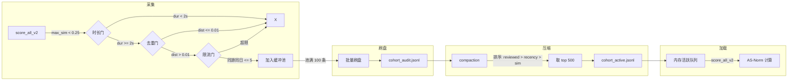

# 冒名者队列（Cohort）系统

> 用于 AS-Norm 自适应分数归一化的"冒名者"说话人嵌入集合，持续从低相似度语音段自动采集。

> **现状注（2026-10-08）**：cohort 的采集、落盘、compaction、热更新全链已迁入**闭源音频内核**（`kernel/axeuh_kernel/audio/voiceprint/`，轨道 K/B4/V10 收口）。真源位置 = **内核 state-dir `{state}/voiceprint/cohort_{active,audit}.jsonl`**；外层原 `voiceprint_service`/`CohortManager`/`ai/data/cache/` 队列文件与 `voiceprints.json` 注册库镜像（`sync_from_kernel` 双写）均已退役（V10，整文件删除）。外层维护入口 `/api/admin/cohort/{reload,compact,stats}` 保留为**内核转发**；注册库概览改读内核 `GET /v1/voiceprint/registry` 元数据快照（P2-K1a）。下文带日期快照段落属历史记录；机制描述已按现状就地更新。

## 落地状态（2026-09-13 更新）

### 当前快照（2026-09-13）

- `cohort_active.jsonl` 500 条，覆盖 6 天（2026-09-03 ~ 09-11，每日 49~100 条），条目 raw sim 中位数 +0.031、范围 0.0~0.248（全部低于 `COLLECT_SIM_MAX=0.25`，无自收）。
- `cohort_audit.jsonl` 4783 条累积审计（只增不减）。
- 自动更新闭环持续运行：buffer 满 100 刷盘进 audit → 每 5 次刷盘触发 compaction → 重选 500 覆盖 active + 同步内存。

### 采集断流修复 + 全量重建（2026-09-05 16:30-17:10，commit 38d0a5eb）

**问题**: audit 停在 8/27 已 9 天无新增（采集断流），且历史 4200 条质量差。

| 问题 | 根因 | 修复 |
|---|---|---|
| 采集断流 | score_all_v2 采集触发硬编码 `max_sim < 0.05`，而真实陌生人 raw sim=0.17-0.23 → 真人声永远进不了队，只有白噪/极远场能采 | `COLLECT_SIM_MAX: 0.05→0.25` + 触发点改引用常量（统一） |
| PANNs 误杀 | `speech_prob≥0.5` 门用 AudioSet 事件分类器 Speech 概率当人声判据，键盘+人声混叠被拉低误杀，音乐/电视 Speech 误放 | **移除 speech_prob 门**（try_collect + compaction 排序），人声由上游 VAD 保证（生产默认 pyannote segmentation-3.0） |
| 旧 audit 质量差 | 4200 条全部 sim<0.05（78% 负值）、无 speech_prob/rms 字段 | 弃用，从每日 perception.jsonl 重采（见下） |
| 重建数据源 | 用户指出应从每天感知 json 拿样本（非 audit、非全文件重扫） | 新脚本 `backend/scripts/rebuild_cohort_from_perception.py` |

**重建结果（audit 683 → active 500）**:
- 从 9/3-9/5 perception.jsonl 筛 1319 条候选（有 ASR 文本 + sim<0.25 + 段长2-15s），按偏移切 wav 采集，命中率 92%
- 新 cohort: 条目 sim med=**+0.144**（0% 负值）、与用户质心全部 <0.25（无自收）、3 天均衡覆盖、100% 含 rms/speech_prob 字段
- 备份: `cohort_audit.bak_质量差_20260905_1652.jsonl`（旧 4200 垃圾留证）

**质量验证（新旧 cohort 对真实音频打分对比）**:
- 用户真实声音（161748 "嗯/麻烦呀", raw 0.37-0.40）: 旧 AS 0.86-0.90 → 新 AS **0.72-0.80**（合理，未虚抬至 0.9）
- 陌生人/老师声: 旧 AS 虚抬为正 → 新 AS **-0.34**（正确压负，假命中消除）
- 结论: 注册质心无问题（raw 0.37-0.40 正常），新 cohort 消除虚抬且不损失用户识别率

### 早前修复（2026-09-05 16:00-16:12）

| commit | 问题 | 修复 |
|---|---|---|
| c14c5f79 | compaction 排序时间用字符串**正序**, 排序后取前500 = 永远保留最早数据, active 停滞在 7/23-7/30, 8月新采集永远进不了队列 | 时间倒序(新数据优先)+质量分; 实测覆盖 8/14-8/27 |
| 1a45399b | 前版多样性贪心虽分散但被单日海量(8/14 有1000条)挤占, 覆盖仅4天 | **按天分组+每日配额+组间轮询**: 覆盖 12 天均衡(7/23-8/27 每日30-49条), 内部 sim 0.143 |

按《声纹系统实施计划-Gap分析》完成 Gap-3（质量+UBM化）+ Gap-4（动态判定）:

| 项 | 状态 |
|---|---|
| Gap-3a 能量门 | score_all_v2 采集传 RMS, `MIN_RMS=0.008` 过滤弱噪声段; entry 落盘 speech_prob/rms/env |
| Gap-3b 多样性 | compaction 质量排序 + 多样性贪心(内部 sim>0.60 视为冗余跳过); 实测内部 sim 0.499→0.188, 来源 209→404 文件, 天数 1→4 |
| Gap-3c 队列重排 | 旧 500 条已重排, 备份 `cohort_active.bak_20260905_旧500.jsonl` |
| Gap-4 动态判定 | `VoiceprintService.score_vs_target(emb, T)`: 负样本 = UBM(活跃队列) + {其他注册身份} − T; 返回 raw/z/dynamic(tanh z/3, 与 AS-Norm 同域) |
| Gap-4 灰区 | ProfileManager 档案并入前判相对显著性: top1-top2 < `margin_min(0.08)` 且 top1 < `open_threshold_strong(0.80)` → 灰区不合并(宁碎勿脏) |

**重建后队列状态（2026-09-05）**: 500 条, 覆盖 3 天(2026-09-03 ~ 2026-09-05)真实人声,
条目 sim med +0.144。已 reload 热更新到运行进程(17:00, PID 6872)。

**自动更新闭环**: buffer 满 100 刷盘进 audit → 每 5 次刷盘自动 compaction →
从 audit 全量重选 500 覆盖写 active + 同步内存。audit 只增不减(历史保留), active 随新数据向最近环境漂移。

设计原则（研究 3.2, 用户原创）: 判 x 是不是 A → 负样本 = 总池 − A; 任何人进池不损害自己的可识别性。

## 概述

### 为什么需要 Cohort

声纹评分系统使用余弦相似度（0~1）衡量两段语音是否为同一说话人。但原始余弦值受录音环境影响严重——同一人在安静/嘈杂环境下的声纹相似度可能相差 0.3 以上，导致阈值难以设置。

AS-Norm（Adaptive Score Normalization）通过一组"肯定不是该用户的说话人嵌入"（即冒名者队列）来校准分数，消除环境噪声差异。

### AS-Norm 公式

```
z_score = (raw_sim - mean(imposter_scores)) / std(imposter_scores)
score = tanh(z_score / 3.0)
```

> `tanh(z_score / 3.0)` 的因子 3 用于防止 z-score 过大时 tanh 饱和输出 ±1。
> 该修复（`f276c51`）解决了分数仅有 1/0/-1 三个离散值的 bug；详细的私有调研记录不进入公开树。

- `raw_sim`：当前音频与目标用户质心的原始余弦相似度
- `mean(imposter_scores)`：当前音频与队列所有条目的余弦相似度均值
- `std(imposter_scores)`：上述相似度的标准差
- `tanh(z/3.0)`：将标准化分数映射到 [-1, 1]，保留分值连续分布

当队列 `< 10` 条时，直接返回原始余弦相似度（不进行归一化）。

### 与声纹评分的关系

声纹评分流程（`score_all_v2`）：

1. 提取音频嵌入向量（192 维），内部通过 `_vad_filter` 只取语音部分
2. 计算与所有注册质心的原始余弦相似度
3. 若 `max_sim < 0.25`（`COLLECT_SIM_MAX`）且音频时长 `>= 2s`：尝试采集为队列候选（2026-09-05 已移除 `speech_prob` 门；人声由上游 VAD 保证，默认 pyannote segmentation-3.0）
4. 若活跃队列 `>= 10`：计算 AS-Norm 归一化分数并返回
5. 若活跃队列 `< 10`：直接返回原始余弦相似度

### 感知数据输出格式

后端对每段 60s 录音做 VAD 切分后，为每个有语音的 VAD 段生成声纹数据。输出保存在 `perception.jsonl` 的 voice 条目中：

```json
{
  "type": "voice", "t": "08:00:56", "dur": 60.0,
  "tag": "self|mixed|other",
  "segs": [{
    "start": 0.0, "end": 3.2,
    "text": "今天天气真好",
    "vp": {
      "spk": "speaker-a",
      "sim": 0.98,        // 整段 AS-Norm 平均分 [-1, 1]
      "max": 1.00,        // 滑窗最高分
      "pct": 0.80,        // 正分窗口占比 [0, 1]
      "ws": [0,0.98,750,0.95,...]  // 扁平滑窗数组 [t_ms,score,...], 1s窗口/750ms步长
    },
    "tokens": [           // 字级声纹分值 (2026-07-23 新增)
      {"c": "今", "v": 0.95},
      {"c": "天", "v": 0.98},
      {"c": "天", "v": 0.99},
      {"c": "气", "v": 0.97},
      {"c": "真", "v": 0.96},
      {"c": "好", "v": 1.00}
    ],
    "emo": {"t": "happy", "p": 0.85}  // 可选: 情绪标签
  }]
}
```

**字段说明**：

| 字段 | 类型 | 说明 |
|------|------|------|
| `vp.spk` | str | 最高分注册声纹名（**注意**：当前无阈值检查，sim≈0 时 spk 标签不可信）|
| `vp.sim` | float | AS-Norm tanh 归一化分值，[-1,1]。>0=偏向用户，<0=偏向他人 |
| `vp.max` | float | 滑窗内最高分值，反映"这 60s 里是否闪过用户声音" |
| `vp.pct` | float | 正分窗口占比 [0,1]，衡量匹配稳定性 |
| `vp.ws` | [float] | 扁平数组 `[t,score,t,score,...]`，高时间分辨率（1s窗/750ms步长）|
| `tokens[]` | [{c, v}] | 每个字符对应的 v2 分值。有窗段→窗值按时间均匀映射；短段（<1s）→统一 sim 值 |
| `tag` | str | 整体标签：`self`(pct>=0.9) / `mixed`(pct>=0.2) / `other`

## 架构设计

> **最后更新**: 2026-09-13 — 采集相似度门 `COLLECT_SIM_MAX` 0.25；PANNs `speech_prob` 门已移除（2026-09-05）。

### 三文件系统

现状（内核 state-dir，1.5.1 迁入）：

```
{kernel state-dir}/voiceprint/
├── cohort_audit.jsonl      # 永久审计日志（只追加）
├── cohort_active.jsonl     # 压缩后活跃工作集（覆盖写入）
└── cohort.jsonl            # 旧单文件（存在则作 legacy 回退读取）
```

> 历史位置为外层 `ai/data/cache/`（`cohort_verified.jsonl` 曾规划为人工审查条目最高优先级文件，内核现行加载链**未实现 verified 一档**，审查工具写回已停用，见"辅助工具"节）。外层 cache 目录现存文件均为迁移前的 `.bak` 存档。

### 加载优先级

历史设计（外层旧实现）：

```
cohort_verified.jsonl  (人工审查，最高优先级)   ← 内核未实现此档（verified 写回已停用）
       ↓ 不存在
cohort_active.jsonl    (压缩后的活跃工作集)      ← 内核现行第一优先
       ↓ 不存在
cohort.jsonl           (旧格式回退读取)
       ↓ 不存在
空池（评分退化为原始余弦）
```

### 数据流

> 下图中"缓冲池/池满 100 批量刷盘"为历史外层语义；内核现行为采集逐条即时落盘（audit 追加 + active 维护），见"缓冲与批量刷盘"节现状注。



## 文件说明

| 文件 | 格式 | 写入模式 | 最大条数 | 用途 |
|------|------|----------|----------|------|
| `cohort_audit.jsonl` | JSONL | 追加（append） | 无上限 | 永久审计日志，每次采集记录完整溯源 |
| `cohort_active.jsonl` | JSONL | 覆盖（overwrite） | 500 | 压缩后的活跃工作集，供运行时加载 |
| `cohort_verified.jsonl` | JSONL | 覆盖（overwrite） | 无上限 | 人工审查通过的条目（手动创建） |

### 条目 JSON Schema

**audit.jsonl 条目**（自动采集）：

```json
{
  "embedding": [0.123, ...],    // 192 维嵌入向量
  "sim": 0.0321,                // 原始余弦相似度
  "dur": 3.45,                  // VAD 有效时长（秒）
  "t": "2026-07-23T14:30:00",   // 采集时间戳
  "env": "quiet",                // 环境标签（可选）
  "src": "2026-07-23_perception.jsonl",  // 源文件名
  "src_start": 123.45,          // 在源文件中的起始偏移（秒）
  "src_end": 126.90,            // 在源文件中的结束偏移（秒）
  "quality": {"snr": 15.2},     // 质量指标
  "status": "auto",             // auto=自动采集, upgraded=旧数据升级
  "reviewed": false,            // 是否已人工审查
  "rejected": false             // 是否被拒绝
}
```

**active.jsonl 条目**（压缩后）：与 audit 格式相同，但仅包含被选中进入活跃工作集的条目。

**verified.jsonl 条目**（人工审查）：与 audit 格式相同，但 `status` 为 `"verified"`, `reviewed` 为 `true`。

## 自动采集

### 质量门（Quality Gates）

采集需同时通过以下全部质量门，任一不通过则拒绝：

| 门控 | 常量 | 说明 |
|------|------|------|
| 时长门 | `MIN_DUR_SEC = 2.0` | VAD 有效语音段至少 2 秒 |
| 相似度门 | `COLLECT_SIM_MAX = 0.25` | 与注册质心最大 raw 相似度 < 0.25（跨人 raw 0.17-0.23 可入队，用户低分场景 raw≥0.26 不入队防自收） |
| 能量门 | `MIN_RMS = 0.008` | 信号 RMS 门槛，过滤弱噪声/极远场段 |
| 去重门 | `DEDUP_MIN_DIST = 0.01` | 与已有活跃队列条目的余弦距离 > 0.01 |
| 限流门 | `MAX_PER_DAY_SRC = 5` | 同一源文件同一天最多采集 5 条 |

> **2026-09-05 移除语音概率门（PANNs speech_prob）**：
> 原 `COLLECT_MIN_SPEECH_PROB = 0.5`（AudioSet 事件分类器的 "Speech" 类概率）不可靠——
> 键盘+人声混叠时概率被拉低误杀真实人声，音乐/电视 Speech 又误放。
> 人声判定由上游 VAD 保证（生产默认引擎 pyannote segmentation-3.0，`VAD_ENGINE=silero` 可回退；VAD 语音段才进打分），此处不再二次过滤。
> 若需过滤弱噪声用 RMS 能量门（0.008）。

### 缓冲与批量刷盘

历史设计（外层旧实现）：采集通过的条目先进入内存缓冲池（buffer），缓冲池满 100 条（`FLUSH_BATCH`）后批量追加写入 `cohort_audit.jsonl`，逻辑在 `CohortManager.try_collect()`/`flush()` 中。

**现状（内核）**：外层 `CohortManager` 已删除；内核 `_persist_collect_entry` **逐条采集即时落盘**（audit 原子追加 + active 维护，持 `_cohort_lock`），无攒批缓冲，`/api/admin/cohort/stats` 的 `buffer` 恒为 0。

### 触发位置

现状：采集入口在内核 `axeuh_kernel/audio/voiceprint/service.py`（打分链 `_collect_facts`，门与判定逐一对齐历史外层 `VoiceprintService.score_all_v2()` 内 `try_collect`——外层该类已迁内核删除）；每次声纹评分若 `max_sim < COLLECT_SIM_MAX(0.25)` 且时长达标，自动尝试采集。唤醒进门打分走内核 `collect=False`，不进 cohort。

采集判定用 **raw 相似度**（AS-Norm 归一化之前），与注册质心逐一算余弦后取最大值。
日志 `vp=1spk/500co(AS)` 中的分数是 AS-Norm 后，不是采集判定用的 raw。

## 定期维护

### compaction 压缩

从 `cohort_audit.jsonl` 全量审计日志中重建 `cohort_active.jsonl` 活跃工作集（现由内核 `cohort_compact_facts` 执行；日常另有采集时 active 满 500 自动增量重建）。

触发方式（外层端点 → 转发内核 `POST /v1/voiceprint/cohort/compact`）：

```bash
curl -X POST https://127.0.0.1:8768/api/admin/cohort/compact
```

压缩流程：

1. 读取审计日志所有条目（跳过 JSON 损坏的行）
2. 过滤掉 `rejected = true` 的条目
3. 排序（优先级：已审查 > 时间倒序 > 相似度升序）
4. 取前 `ACTIVE_SIZE`（500）条
5. 覆盖写入 `cohort_active.jsonl`
6. 原子替换内存中的活跃队列

排序依据：

```python
sort_key = (-reviewed, -t_recency, sim_ascending)
```

### 热更新（reload）

真源在内核 state-dir（`{state}/voiceprint/cohort_active.jsonl`）；该文件被外部更新后可通过热更新使内核内存队列生效，无需重启：

```bash
curl -X POST https://127.0.0.1:8768/api/admin/cohort/reload
```

## 管理端点

| 方法 | 端点 | 说明 |
|------|------|------|
| POST | `/api/admin/cohort/reload` | 热更新队列（转内核 `POST /v1/voiceprint/cohort/reload`） |
| POST | `/api/admin/cohort/compact` | 手动触发压缩重建（转内核 `POST /v1/voiceprint/cohort/compact`） |
| GET | `/api/admin/cohort/stats` | 查看活跃/缓冲计数（转内核 `GET /v1/voiceprint/cohort/stats`；缓冲恒 0） |

> B4/V10 起三端点为纯转发（`backend/routers/admin.py`），cohort 唯一真源在内核 state-dir，外层不再直接读写队列文件。

使用示例：

```bash
# 队列状态
curl -sk https://127.0.0.1:8768/api/admin/cohort/stats \
  -H "Authorization: Bearer <token>"
# {"active": 50, "buffer": 23}

# 触发压缩
curl -sk -X POST https://127.0.0.1:8768/api/admin/cohort/compact \
  -H "Authorization: Bearer <token>"
# {"success": true, "active": 500, "total_audit": 1523, "message": "压缩完成: 活跃 500 条"}

# 热更新
curl -sk -X POST https://127.0.0.1:8768/api/admin/cohort/reload \
  -H "Authorization: Bearer <token>"
# {"success": true, "active": 500, "message": "队列已热更新: 500 条"}
```

## 旧数据兼容

> **现状注**：以下为外层旧 `CohortManager` 首启迁移机制（历史记录）。迁移完成后队列真源已入内核 state-dir；内核现行加载链是运行时回退读 `cohort.jsonl`（legacy 档），不再执行下述"转格式 + 写 audit/active + 重命名 .bak"的迁移动作。

旧系统使用单文件 `cohort.jsonl`（条目格式：`t: "seed"`，含 `embedding/sim/env/db/file/start/end/snr` 字段）。首次启动 `CohortManager` 时自动迁移：

1. 读取 `cohort.jsonl` 所有条目
2. 转换为新格式（新增字段）
3. 全部追加到 `cohort_audit.jsonl`
4. 取前 500 条写入 `cohort_active.jsonl`
5. 将 `cohort.jsonl` 重命名为 `cohort.jsonl.bak`

格式转换新增字段：

| 字段 | 值 |
|------|------|
| `status` | `"upgraded"` |
| `reviewed` | `false` |
| `rejected` | `false` |
| `src` | 从 `file` 或 `src` 字段迁移 |
| `dur` | 从 `end - start` 计算 |
| `quality` | `{"snr": snr值}` |

## 辅助工具

### cohort_review_server.py（已停用写回，DEPRECATED 2026-09-24 / Wave B4）

基于 HTTP 的负样本审查网页工具，运行在 `http://example.com:18890`（frp 映射）。

**现状处置**：数据源已迁内核 state-dir，本工具写外层本地文件即"分裂脑"，**「导出确认样本」写回已停用（返回 501）**——verified 加载优先级在内核侧不存在（内核 `load_cohort` 只读 `cohort_active.jsonl`/`cohort.jsonl`），且工具导出的 `embedding` 恒为 `[]`，历史上也从未真正入池。

- **只读审查 + 音频试听功能仍可用**（候选筛选数据源是 `perception.jsonl`，属外层业务 IO，离线人工复核候选负样本）
- **过渡期人工审查请用 `frontend/vaudit/` 审计台**（已切内核 audit 端点，展示 reviewed/rejected 徽标；压缩时 `rejected=true` 条目由内核 compact 过滤）
- 正式方案待内核 additive 的 cohort review 写回端点（缺口已登记，建议形状 `POST /v1/voiceprint/cohort/review`）

**历史功能说明（写回停用前）**：

**功能**：

- 扫描 `perception.jsonl` 中的语音段，自动识别新旧两种格式：
  - 旧格式：`segments[].voiceprint_sim`（余弦相似度，`< 0.05` 为负样本）
  - 新格式：`segs[].vp.sim`（AS-Norm 分数，`< 0` 为负样本）
- 自动过滤整分钟包裹段（仅 1 个 seg 且 `dur >= 55s`→跳过）
- 筛选条件：文本 `>= 5` 字符、不含 `<|nospeech|>`/`<|Event_UNK|>`、时长 `>= 3s`
- 提供 Web 界面：语音播放 + 审批/拒绝按钮
- 审批通过的条目导出到 `ai/data/cohort_verified.jsonl`

**使用方式**：

```bash
python scripts/cohort_review_server.py
# 浏览器打开 http://example.com:18890
```

**注意事项**：

- 音频文件缓存到 `/opt/kinship/cohort-review`
- 导出后需将 `cohort_verified.jsonl` 放入 `ai/data/cache/` 目录，然后调 `/api/admin/cohort/reload` 热加载
- 该工具独立于后端运行，不依赖 FastAPI 服务

## 性能考虑

### 活跃工作集上限

`ACTIVE_SIZE = 500`。超过此数时，压缩操作自动截断。500 条是经验和性能的平衡点：

- 足够多的冒名者样本覆盖多种环境噪声
- 单次 AS-Norm 计算涉及 500 次余弦相似度，约 0.5ms
- 如需更大规模，可改为向量化计算（`np.dot` 批量）

### 审计日志

审计日志是追加写入，无性能瓶颈。用于：

- 追踪所有采集事件的完整溯源
- 压缩时重建活跃工作集

### 内存占用

- 每条嵌入 192 维 float64 = 1.5KB
- 500 条活跃队列 ≈ 750KB
- 缓冲池条目（含元数据）≈ 100 条 ≈ 200KB

## 故障排查

### 文件缺失

队列目录不存在时自动创建：`os.makedirs(cohort_dir, exist_ok=True)`。首次启动无任何文件时，队列为空，评分退化为原始余弦相似度。

### 压缩失败

异常时返回当前活跃队列大小，不影响服务。日志会记录 `[Voiceprint] 压缩失败: {error}`。

### 审计日志损坏

读取审计日志时，损坏的 JSON 行自动跳过（try-except），不阻塞后续操作。压缩时坏行之后的正常条目仍可被处理。

### 旧数据迁移失败

`_migrate_legacy` 内部捕获所有异常并记录 `[Voiceprint] 队列升级失败: {error}`，不阻止后端启动。

## 配置参考

旧键 `voiceprint.cohort_max_samples`（外层 `config.py` 属性，默认 10000，仅用于旧格式迁移读取上限）**已死**：属性已从 `config.py` 移除，外层不再读。

现行工作集上限 = 内核常量 `DEFAULT_MAX_ACTIVE = 500`（`axeuh_kernel/audio/voiceprint/cohort.py`），对应外层 `audio.voiceprint.cohort.active_size`（`backend/services/audio_config.py` 内置 500，随 config_override 传内核，注释明确"取代死配置 voiceprint.cohort_max_samples"）。门阈值常量以内核 `cohort_lib` 为准（9-05 调优资产，数值不许漂移）。

## 核心技术常量

现状位置：内核模块 `axeuh_kernel/audio/voiceprint/cohort.py` 模块级常量（原外层 `CohortManager` 类属性已随迁移删除；数值与 9-05 调优资产一致，不许漂移）。

| 常量 | 值 | 内核位置 |
|------|-----|------|
| `MIN_DUR_S` | 2.0 | `cohort.py`（采集时长下限；旧名 `MIN_DUR_SEC`） |
| `COLLECT_SIM_MAX` | 0.25 | `cohort.py`（2026-09-05 由 0.05 上调） |
| `COLLECT_MIN_SPEECH_PROB` | — | 2026-09-05 已移除（PANNs 语音概率门不再使用） |
| `MIN_RMS` | 0.008 | `cohort.py` |
| `DEDUP_MIN_DIST` | 0.01 | `cohort.py` |
| `MAX_PER_DAY_SRC` | 5 | `cohort.py` |
| `DEFAULT_MAX_ACTIVE` | 500 | `cohort.py`（旧名 `ACTIVE_SIZE`） |
| `FLUSH_BATCH` | 100 | 仅旧外层缓冲语义；内核逐条即时落盘，无此缓冲 |

> 旧表末行 `cohort_max_samples`（10000）对应死键，处置见上文"配置参考"节，此处不再列为现行常量。
