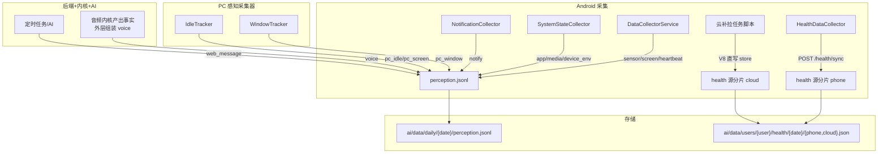

# Kinship 数据格式

> 基于实际 `perception.jsonl` 数据的完整格式说明

系统数据按日期组织：感知事件存于 `ai/data/daily/{YYYY-MM-DD}/perception.jsonl`；健康数据真源为按用户分片存储 `ai/data/users/{user_id}/health/{YYYY-MM-DD}/{phone,cloud}.json`（P2-V9 起派生文件 `daily/{date}/health.json` 已停新写，仅存历史日，见第 2 节）。

---

## 目录

- [1. 感知数据 (perception.jsonl)](#1-感知数据-perceptionjsonl)
  - [1.1 voice -- 语音事件](#11-voice--语音事件)
  - [1.2 sensor -- 传感器快照](#12-sensor--传感器快照)
  - [1.3 app -- 前台应用切换](#13-app--前台应用切换)
  - [1.4 screen -- 屏幕锁定/解锁](#14-screen--屏幕锁定解锁)
  - [1.4b heartbeat -- App 存活心跳](#14b-heartbeat--app-存活心跳)
  - [1.5 device_env -- 设备环境](#15-device_env--设备环境)
  - [1.6 media -- 媒体播放状态](#16-media--媒体播放状态)
  - [1.7 pc_window -- Windows 前台窗口](#17-pc_window--windows-前台窗口)
  - [1.8 web_message -- Web/AI 消息](#18-web_message--webai-消息)
  - [1.9 其他事件类型](#19-其他事件类型)
- [2. 健康数据 (health.json)](#2-健康数据-healthjson)
- [3. 健康上传 API](#3-健康上传-api)
- [4. 数据类型汇总](#4-数据类型汇总)

---

## 1. 感知数据 (perception.jsonl)

**路径**: `ai/data/daily/{YYYY-MM-DD}/perception.jsonl`
**格式**: 每行一个 JSON 对象（`\n` 分隔，增量追加）
**读方**: 统一经 `backend/services/perception_reader.py`（P2-V11 唯一 reader 入口，六读方已收编：mobile/preview/voiceprint_audit/audio_compressor/AI 脚本等）。新代码不得自行逐行解析该文件。

### 公共字段

所有事件条目都有以下基本字段：

| 字段 | 类型 | 说明 |
|------|------|------|
| `type` | string | 事件类型 |
| `t` | string | 时间 `HH:mm:ss`（北京时间） |
| `t_iso` | string (可选) | ISO 8601 时间戳（PC 事件通常有） |
| `_source` | string (可选) | 数据来源标识（PC 事件为 `"pc_sensor"`） |
| `_agent_id` | string (可选) | 上报 Agent ID（PC 事件） |
| `_agent_name` | string (可选) | 上报 Agent 名（PC 事件，如 `"服务器"`） |
| `device_name` | string (可选) | 上报设备名（手机事件通常有，如 `"example-phone"`） |

---

### 1.1 voice -- 语音事件

由音频录制触发（App 端按 `audio_segment_ms` 固定分段（默认 60s）、再按 `audio_upload_batch_ms` 批量上传；后端按 `device_id` 把时间连续的上传分段维护成一条**无缝流**——`B.start_ms <= A.end_ms + audio.stream.stitch.tolerance_ms`（默认 1000ms）即同一条流，**不在文件边界切分**；超容差 / 设备变化 / 时间倒流则先冲刷当前流再开新流；逐帧静音切分委托音频内核（WS `mode:"segment"` 通道，2026-09-25 起），合并后的 PCM **整段**送 ASR，故一条 `voice` 条目可能由多个上传分段合并而来，且跨文件的一句话不会被断句）。包含 VAD/说话人切分、ASR、声纹打分（`vp`）、音频事件与场景——**这些事实全部由独立闭源音频内核（`kernel/`）计算产出，外层只做喂送、时间对齐与落盘组装（内容归内核/位置归外层）**；外层无任何音频算法实现。声纹分值已做 AS-Norm 归一化（`tanh(z/3)`，范围 [-1,1]），不是原始余弦值。

> **来源隔离（2026-09-15）**：只有**上传**来源的音频写入本文件。语音唤醒的**流式**音频（`WS /ws/audio-stream`）不产生 `voice` 条目，其音频落在 `ai/data/stream/{date}/audio/`（`daily/` 之外），仅把 ASR 结果作为语音指令投递主会话。分析链路以 `origin="upload"|"stream"` 溯源；`audio.stream.persist_perception=true`（默认 false）才会让流式音频也写入本文件（调试用）。

> **上传格式双档（2026-09-23）**：客户端可选 **WAV（原始）或 FLAC（无损，约省 46% 流量）**——App 设置页「环境音频 → 上传格式」（prefs `audio_upload_format`，默认 `wav`），每段采集现读、改完下一段生效。后端对 multipart 上传做 **magic 嗅探**（`RIFF`+8-11 位 `WAVE`，或偏移 0 `fLaC`；裸 RIFF 也匹配 WebP/AVI 故必须配 `WAVE`，不信任 Content-Type），解码到统一 16k/mono/s16 PCM 进无缝流（**水位/去重/切分全格式无关，600 行核心零改**），chunk 按上传格式封装落盘（`daily/{date}/audio/...{.wav|.flac}`），`perception.jsonl` 的 `audio` 字段仍指实际落盘文件（**单指针不变**）；magic 嗅探未知时回退 `audio.store.upload_ext`（默认 `wav`，非法值回退 `wav`）。App 侧编码：`FlacFinalizer` MediaCodec `audio/flac` 首选 + java-flac-encoder 0.3.8 兜底（Maven Central，LGPL-2.1），**编码失败自动降级 WAV 绝不丢数据**；checkpoint `finalize` 按格式产出 `{base}.wav|.flac` + JSON `format` 字段，崩溃恢复按 sidecar `format` 重建对应后缀。分析链 `_ensure_wav` 对 FLAC 走 `{stem}.analysis.wav` **旁路转码**（原文件字节不变，`jsonl` 仍指原件）；**旁路是瞬态衍生品，`analyze_audio_file` 结束即在 `finally` 清理，数据目录只持久保存 `.wav`/`.flac` 原件**（`audio_compressor` 归档清单亦排除 `.analysis.wav`）。**降级注记**：App 侧 FLAC 收尾若崩溃未 patch STREAMINFO total-samples，文件仍是合法 FLAC（时长未知=0，解码/分析不受影响，接受此降级）。
>
> **热生效现状（2026-09-23 核查）**：GPS / 系统状态 / 通知 / 健康 / 声音的全部采集参数**已循环内现读**（GpsCollector:124 / SystemStateCollector:113 / NotificationCollector:111 / HealthDataCollector:85 / AudioCollector `audio_segment_ms`:736 + `audio_upload_batch_ms`:879 + `hint_tone_volume`:1377），设置页写 prefs 后主循环 ≤30s `applyToggle`（DataCollectorService:660/:758）即生效；唯一死参组 KWS 四参有 `requestKwsReload` 旗标模板（AudioCollector:160-162/:926-933）；**`audio_upload_format` 照 :736 每段现读天然 live**。音频设置不依赖 `OnSharedPreferenceChangeListener`——**不建 reload 总线**，改完 App 下一段/下一轮生效（该监听器仅用于 Android token 桥，见 `docs/android-webview-token-bridge-2026-10-25.md`）；后端 `audio.*` 配置仍需重启（`POST /api/screen/restart`，进程级缓存）。

```json
{
  "type": "voice",
  "t": "11:28:31",
  "dur": 60.0,
  "tag": "mixed",
  "text": "啊。",
  "audio": "daily/2026-09-13/audio/112827_default.wav",
  "scene": "说话声",
  "segs": [
    {
      "start": 49.2,
      "end": 51.1,
      "text": "啊。",
      "vp": {
        "spk": "speaker-a",
        "sim": 0.6745,
        "max": 0.8932,
        "pct": 0.5,
        "ws": [0, 0.8932, 750, -0.3212],
        "ws_spk": ["speaker-a", ""]
      },
      "tokens": [ { "c": "啊", "v": 0.8932 }, { "c": "。", "v": -0.3212 } ],
      "word_ts": [[49290.0, 49350.0], [51030.0, 51090.0]],
      "words": ["啊", "。"],
      "spk": {
        "id": "mixed",
        "kind": "mixed",
        "name": null,
        "unk_id": null,
        "ref_sim": 0.6745,
        "count": null,
        "is_new": false
      }
    }
  ],
  "ac": { "db": -22.3, "spk": 100.0 },
  "env": ["安静", "Writing", "安静", "Mouse", "Mechanisms"],
  "device_name": "example-phone"
}
```

**entry 级字段：**

| 字段 | 类型 | 说明 |
|------|------|------|
| `dur` | float | 录音时长（秒）；上传分段经无缝流合并后为合并块时长，不再固定 60.0 |
| `tag` | string | 整体标签：`self`(pct>=0.9) / `mixed`(pct>=0.2) / `other` |
| `text` | string | 整段音频 ASR 文本摘要 |
| `audio` | string | 原始音频路径（相对 `ai/data/`）；上传来源为 `daily/{date}/audio/...{.wav|.flac}`（双档，见上「上传格式双档」），流式来源（不写本文件）为 `stream/{date}/audio/...` |
| `scene` | string | 场景分类最佳猜测（如 `"说话声"`、`"Animal"`） |
| `segs` | array | 切分后的语音段（见下） |
| `ac` | object | 声学特征：`db`(整体分贝) / `spk`(人声占比 %) |
| `env` | array | 环境音事件标签列表（PANNs） |
| `device_name` | string | 上报设备名 |
| `unk` | object (可选) | 已确认陌生人摘要，仅当本段出现 confirmed 陌生人时写入：`{id, count, seg_count, score}` |

**segs[] 字段：**

| 字段 | 类型 | 说明 |
|------|------|------|
| `start` | float | 段在 60 秒音频中的起始秒 |
| `end` | float | 结束秒 |
| `text` | string | ASR 识别文本（无语音段为 `"<\|nospeech\|>"`） |
| `vp` | object | 声纹打分（见下） |
| `tokens` | array | 字级声纹分值 `[{c, v}]`（按真实时间对齐） |
| `word_ts` | array | 字级时间戳 `[[start_ms, end_ms], ...]` |
| `words` | array | 分词结果 |
| `spk` | object | 说话人身份结论（见下） |

**vp 字段（声纹）：**

| 字段 | 类型 | 说明 |
|------|------|------|
| `spk` | string | 最高分注册声纹名；低分时为空串（不可信） |
| `sim` | float | 整段 AS-Norm 平均分 [-1,1] |
| `max` | float | 滑窗最高分 |
| `pct` | float | 正分窗口占比 [0,1] |
| `ws` | array (可选) | 扁平滑窗数组 `[t_ms, score, t_ms, score, ...]`，1s 窗 / 750ms 步长 |
| `ws_spk` | array (可选) | 每窗说话人标记（含 `unk_id`），与 `ws` 一一对应 |

**spk 字段（说话人结论）：**

| 字段 | 类型 | 说明 |
|------|------|------|
| `id` | string | 身份 ID：注册名 / `unk_*` / `mixed` / `env` |
| `kind` | string | `registered` / `unknown` / `mixed` / `env` |
| `name` | string/null | 注册人名；未知/混合/环境为 null |
| `unk_id` | string/null | 陌生人档案 ID（pending 阶段也会携带） |
| `ref_sim` | float | 参考相似度（AS-Norm 分值） |
| `count` | int/null | confirmed 陌生人的累计段数 |
| `is_new` | bool | 本次是否为新建档案 |
| `unk_status` | string (pending 时) | pending 阶段的档案状态 |
| `unk_count` | int (pending 时) | pending 阶段的累计段数 |

**tokens[] 字段：** `{ "c": 字符, "v": 该字 AS-Norm 分值 }`。

**声纹置信度参考：**

| 分值范围 | 含义 |
|:----------:|------|
| >= 0.75 | 高置信注册人（`spk.kind=registered`） |
| 0.30 ~ 0.75 | 混合/不确定（`spk.kind=mixed`） |
| < 0.30 | 环境音/他人（`spk.kind=env`） |
| `pct` / `tag` | 有滑窗时优先看 `pct` 与整体 `tag` |

> 旧格式（`segments[]` / `voiceprint_sim` / `audio_events[]` / `hasSpeech`）为 2026-07 之前的版本，现已被上述 `segs[] + vp + spk` 结构取代。若需处理历史数据，请按 `segments` 字段是否存在做分支兼容。

---

### 1.2 sensor -- 传感器快照

由 Android 每分钟采集。所有字段扁平，无 `payload` 嵌套。

```json
{
  "type": "sensor",
  "t": "00:00:06",
  "gps": "<lat>,<lon>",
  "gps_accuracy": 30,
  "phone_battery": 52,
  "device_name": "example-phone"
}
```

| 字段 | 类型 | 说明 |
|------|------|------|
| `gps` | string (可选) | `"latitude,longitude"` 字符串 |
| `gps_accuracy` | int (可选) | GPS 精度（米） |
| `phone_battery` | int (可选) | 手机电量百分比 0-100 |
| `hr` | int (可选) | 心率（来自手机传感器快照） |
| `steps` | int (可选) | 步数 |

> **注意**：GPS 在后台可能被系统抑制，长时间不变不代表位置没变。

---

### 1.3 app -- 前台应用切换

```json
{
  "type": "app",
  "t": "09:37:17",
  "app": "系统桌面",
  "device_name": "example-phone"
}
```

| 字段 | 类型 | 说明 |
|------|------|------|
| `app` | string | 前台应用名称 |

---

### 1.4 screen -- 屏幕锁定/解锁

```json
{
  "type": "screen",
  "t": "00:00:03",
  "locked": false,
  "device_name": "example-phone"
}
```

| 字段 | 类型 | 说明 |
|------|------|------|
| `locked` | bool | 屏幕是否锁定 |

---

### 1.4b heartbeat -- App 存活心跳

App 主循环每个上传周期（`loop_ms`，默认 30s）无条件发一条「存活 + 当前状态」断言，与事件流（screen/app 只在变化时写）互补：某时段无 screen/app 行时，凭 heartbeat 序列可区分"状态真没变"与"采集器离线/被杀"。

```json
{
  "type": "heartbeat",
  "t": "14:03:22",
  "locked": true,
  "phone_battery": 82,
  "app": "微信",
  "device_name": "example-phone"
}
```

| 字段 | 类型 | 说明 |
|------|------|------|
| `locked` | bool (可选) | 当前屏幕锁定态（`PowerManager.isInteractive`，恒有——不受 screen_state_enabled 门控） |
| `phone_battery` | int (可选) | 电量百分比（受 battery_enabled 门控） |
| `app` | string (可选) | 最后已知前台应用显示名（受 foreground_enabled 门控，取采集器去重缓存，未采集过则省略） |

> **语义注意**：heartbeat 不携带"变化"含义，消费方（fact_extractor `_collect_heartbeat`）只做 carry-forward 状态更新与存活计数，**不并入 screen_times / apps 时间线**；`app` 字段是"最后已知"而非"此刻确认前台"（熄屏后 UsageStats 冻结，值可能陈旧）。

---

### 1.5 device_env -- 设备环境

```json
{
  "type": "device_env",
  "t": "00:00:04",
  "screen": { "locked": false },
  "device_name": "example-phone"
}
```

device_env 可能包含以下子对象（按实际情况出现，非全部同时存在）：

- `screen`: `{ "locked": true/false }` -- 屏幕锁状态
- `wifi`: `{ "ssid": "MyWiFi", "rssi": -65, "linkSpeed": 866, "connected": true }` -- WiFi 信息
- `bluetooth`: `[{ "name": "Hand Ring", "address": "AA:BB:CC:DD:EE:FF", "profile": 1 }]` -- 蓝牙设备列表
- `network`: `{ "type": "wifi", "mobileData": false }` -- 网络类型

---

### 1.6 media -- 媒体播放状态

```json
{
  "type": "media",
  "t": "01:21:01",
  "media_app": "网易云音乐",
  "media_title": "祥风时雨",
  "media_artist": "塞壬唱片-MSR/Salty Salt/Elvin Shen",
  "media_duration": 187506,
  "media_state": "paused",
  "device_name": "example-phone"
}
```

| 字段 | 类型 | 说明 |
|------|------|------|
| `media_app` | string | 播放器应用名 |
| `media_title` | string | 歌曲/媒体标题 |
| `media_artist` | string | 艺术家 |
| `media_duration` | int | 总时长（毫秒） |
| `media_state` | string | 播放状态: `playing` / `paused` / `buffering` / `stopped` / `skipping` |

---

### 1.7 pc_window -- Windows 前台窗口

由 PC 感知采集器上报，均有 `_source: "pc_sensor"` 和 `_agent_id` 字段。

```json
{
  "type": "pc_window",
  "t": "11:36:12",
  "t_iso": "2026-09-13T11:36:12.109449+08:00",
  "payload": {
    "process": "Code.exe",
    "title": "AGENTS.md - 无标题 (工作区) - Visual Studio Code [管理员]",
    "pid": 15608
  },
  "_source": "pc_sensor",
  "_agent_id": "server-pc",
  "_agent_name": "服务器"
}
```

| 字段 | 类型 | 说明 |
|------|------|------|
| `payload.process` | string | 进程名称 |
| `payload.title` | string | 窗口标题 |
| `payload.pid` | int | 进程 ID |

---

### 1.8 web_message -- Web/AI 消息

由后端或 AI 系统写入的消息事件。

```json
{
  "type": "web_message",
  "t": "21:28:06",
  "content": "[用户上传了 1 个文件:]\n- D:/path/to/file.jpg\n(无文字)",
  "source": "web_message",
  "user_qq": "Axeuh"
}
```

| 字段 | 类型 | 说明 |
|------|------|------|
| `content` | string | 消息内容 |
| `source` | string | 消息来源，如 `"task_trigger"`, `"web_message"` |
| `user_qq` | string (可选) | 用户标识 |

文件上传示例：

```json
{
  "type": "web_message",
  "t": "00:20:08",
  "content": "[用户上传了 1 个文件:]\n- D:/path/to/file.jpg\n(无文字)",
  "source": "web_message"
}
```

---

### 1.9 其他事件类型

**notify -- 通知事件**（Android 通知，字段扁平）：

```json
{
  "type": "notify",
  "t": "19:41:03",
  "app": "com.tencent.mobileqq",
  "title": "Axeuh_home",
  "text": "[文件]",
  "time": "2026-06-24 19:41:00"
}
```

**notify_summary -- 通知汇总**（周期统计各 App 通知数）：

```json
{
  "type": "notify_summary",
  "t": "11:10:16",
  "total": 13,
  "apps": { "com.miui.securitycenter": 1, "com.axeuh.assistant.dev": 3 }
}
```

**input -- 输入事件**（Android 输入框变化）：

```json
{
  "type": "input",
  "t": "19:08:20",
  "pkg": "com.axeuh.assistant",
  "chars": 0,
  "added": 0,
  "className": "android.widget.EditText"
}
```

**balance -- DeepSeek 余额**（常驻脚本 `deepseek_balance_monitor.py` 每累计消耗 5 元写入一条）：

```json
{ "type": "balance", "t": "13:15:57", "balance": 32.13, "currency": "CNY" }
```

**pc_idle -- PC 空闲状态**（带 `_source/_agent_id/_agent_name`）：

```json
{ "type": "pc_idle", "t": "09:50:19", "t_iso": "2026-09-13T09:50:19.493324+08:00", "payload": { "state": "active", "idle_seconds": 0 }, "_source": "pc_sensor", "_agent_id": "server-pc", "_agent_name": "服务器" }
```

**pc_screen -- PC 屏幕锁定**：

```json
{ "type": "pc_screen", "t": "14:30:25", "payload": { "state": "lock" } }
```

**profile -- 会话画像事件**（占位事件，仅时间戳）：

```json
{ "type": "profile", "t": "19:32:44" }
```

**sample -- 旧版音频样本**（早期版本，已被 `voice` 取代，保留历史数据）：

```json
{
  "t": "20:07:09",
  "text": "<|nospeech|><|Event_UNK|>.",
  "duration": 60.0,
  "has_speech": false,
  "segments": [{ "text": "...", "emo": "悲伤", "conf": 0.12 }],
  "sensors": { "steps": 17, "hr": 79, "battery": 88, "phone_battery": 86 },
  "audio": "audio\\2026-06-06\\200709_default.wav",
  "type": "sample",
  "_saved_at": "2026-06-06 20:07:09"
}
```

> 少数早期条目无 `type` 字段（直接以 `t/text/duration/emotion/scene/audio` 组织），属历史遗留，按"无 type"处理即可。

---

## 2. 健康数据 (health.json)

**现行真源**: `ai/data/users/{user_id}/health/{YYYY-MM-DD}/{phone,cloud}.json`（源分片，按 (user, date) 粒度锁内读-改-写，同目录临时文件 + `os.replace` 原子替换；写方 = 后端 `HealthStore`）。`phone` 分片由手机端 `/api/health/sync` 写入；`cloud` 分片由小米健康云拉取任务写入（接入方式见 `docs/数据源-小米健康云.md`）。
**派生视图**: `ai/data/daily/{YYYY-MM-DD}/health.json` —— P2-V9（2026-10-08）起 `export_legacy` 双写已退役，仅剩历史日存量（只读存量，不再每次同步更新）。现行读方一律经 `HealthStore.read_view(user_id, date)` 合成分片（cloud 先、phone 后，同 t 后写覆盖），形状与下述派生文件一致。
**AI 侧读方**: `ai/analysis/health_source.py`（P2-V11 共享层，分片合成优先、派生文件回落）。
**格式**: 单 JSON 对象，每天一条（下述字段描述读方合成后的视图形状）。

```json
{
  "date": "2026-09-13",
  "updated_at": "2026-09-13T14:59:48.294291+08:00",
  "samples": [
    {
      "t": 1789228800,
      "t_iso": "2026-09-13 00:00:00",
      "hr": 72
    }
  ],
  "daily_summary": {},
  "sleep_data": { "duration_min": 450, "deep_min": 120, "light_min": 230, "rem_min": 100, "awake_min": 30, "awake_count": 4, "stages": [] },
  "device_name": "example-phone"
}
```

> `daily_summary` 可能为空对象 `{}`（设备未回传当日汇总时）；`samples` 视设备上报而定，可含 `hr/steps/stress/spo2/battery`。

### samples 字段说明

| 字段 | 类型 | 说明 |
|------|------|------|
| `t` | int | Unix 时间戳（秒） |
| `t_iso` | string | 可读时间（自动添加） |
| `hr` | int | 心率 0-250 |
| `steps` | int (可选) | 步数（累积值） |
| `stress` | int (可选) | 压力 0-255 |
| `spo2` | int (可选) | 血氧 0-100 |
| `battery` | int (可选) | 电量 0-100 |

### daily_summary 字段说明

```json
{
  "daily_summary": {
    "steps": 8542,
    "hr_resting": 62,
    "hr_avg": 78,
    "hr_max": 145,
    "hr_min": 58,
    "stress_avg": 28,
    "spo2_avg": 97,
    "calories": 1850,
    "training_load": 120
  }
}
```

| 字段 | 类型 | 说明 |
|------|------|------|
| `steps` | int | 总步数 |
| `hr_resting` | int | 静息心率（当日最低） |
| `hr_avg` | int | 平均心率 |
| `hr_max` / `hr_min` | int | 最高/最小心率 |
| `stress_avg` | int | 平均压力 |
| `spo2_avg` | int | 平均血氧 |
| `calories` | int | 卡路里 |
| `training_load` | int | 训练负荷 |

### sleep_data 字段说明

```json
{
  "sleep_data": {
    "duration_min": 450,
    "deep_min": 120,
    "light_min": 230,
    "rem_min": 100,
    "awake_min": 30,
    "awake_count": 4,
    "bedtime": 1790000000,
    "wakeup_time": 1790028800,
    "stages": [
      { "t": "23:00", "stage": "deep" },
      { "t": "00:30", "stage": "light" },
      { "t": "02:00", "stage": "rem" },
      { "t": "06:30", "stage": "light" }
    ],
    "sleep_sessions": [
      {
        "bedtime": 1790000000,
        "wakeup": 1790028800,
        "duration": 450,
        "deep": 120,
        "light": 230,
        "rem": 100,
        "awake": 30,
        "awake_count": 4,
        "items": [
          { "start_time": 1790000000, "end_time": 1790003600, "state": 2 }
        ],
        "stages": [
          { "t": "23:00", "stage": "deep" }
        ]
      }
    ]
  }
}
```

| 字段 | 类型 | 说明 |
|------|------|------|
| `duration_min` | int | 睡眠分钟数 = `deep_min + light_min + rem_min`，**不含清醒** |
| `deep_min` / `light_min` / `rem_min` | int | 各睡眠阶段分钟 |
| `awake_min` | int | 清醒分钟；`duration_min + awake_min` = 在床时长 |
| `awake_count` | int | 夜间清醒次数 |
| `bedtime` / `wakeup_time` | int | 入睡 / 起床 Unix 时间戳（秒） |
| `stages` | array | 阶段时间线 `{t: "HH:mm", stage: "deep"}` |
| `sleep_sessions` | array | 当日全部睡眠记录（主觉 + 午睡/补觉），item schema `{bedtime,wakeup,duration,deep,light,rem,awake,awake_count,items,stages}` |
| `sleep_sessions[].items` | array | 原始阶段片段 `{start_time,end_time,state}`，`state` 保留源端数值编码 |

`stage` 取值: `"deep"` / `"light"` / `"rem"` / `"awake"` / `"unknown"`（canonical 字符串）。源端数字码在 adapter 内映射：小米云 `items[].state` `2/3/4/5` → deep/light/rem/awake（`1`/未使用 → unknown）；手机端同样 `2/3/4/5` → deep/light/rem/awake。

一天可有多条睡眠记录：顶层字段镜像 `duration` 最长的**主觉**；午睡/补觉只出现在 `sleep_sessions[]`，不会合并进主觉或覆盖顶层字段。

---

## 3. 健康上传 API

基础地址：`https://<host>:8768`（HTTP 与 HTTPS 同端口 8768，由 ssl.enabled 决定协议；本地与公网一致）。路由前缀 `/api/health`，定义见 `backend/routers/health.py`。用户归属由认证头解析（`_require_user_id`），写入即落到该用户的源分片。

### POST /api/health/sync

请求体：

```json
{
  "samples": [
    { "t": 1719300000, "hr": 72, "steps": 1245, "stress": 25, "spo2": 98 }
  ],
  "daily_summary": { "steps": 8542, "hr_resting": 62 },
  "battery_levels": [ { "t": 1719300000, "level": 85 } ],
  "sleep_data": { "duration_min": 450, "stages": [...] },
  "client_time": "2026-06-25T14:30:25+08:00",
  "device_name": "example-phone"
}
```

可选字段（H5 新增，Android 不传不受影响）：`source`（`"phone"`|`"cloud"`，默认 phone）、`device_id`（云源为 `cloud:{userId}`）、`date`（云补拉历史日锚点）。P2-V8 起云生产链路改任务脚本直写分片（不再 POST 本端点），`source=cloud` 分支仅剩端点兼容保留。

响应：

```json
{
  "status": "ok",
  "dates": ["2026-06-25"],
  "stats": {
    "samples": 12,
    "dates_updated": ["2026-06-25"]
  }
}
```

### GET /api/health/query?date=YYYY-MM-DD

返回指定日期的健康数据完整内容（按认证用户读其源分片，经 `read_view` 合成派生视图形状；分片全缺时回落历史派生文件）。

> **已退役端点（P0-U3，2026-10-08 裁剪）**：`POST /api/health/upload-db`（Gadgetbridge SQLite 上传重建）与 `GET /api/health/dates` 已删除，不再提供。

---

## 4. 数据类型汇总



感知数据在 `ai/data/daily/{YYYY-MM-DD}/` 下按日期组织；健康数据真源在 `ai/data/users/{user_id}/health/{YYYY-MM-DD}/` 按用户与日期分片（派生 `health.json` 仅历史存量）。AI 分析系统以此为基础进行数据检查和报告生成。
