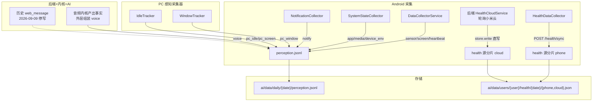

# Kinship 数据格式

> 基于实际 `perception.jsonl` 数据的完整格式说明（2026-11-17 对照生产落盘数据与写入代码复核；历史字段已就地标注）。

系统数据按日期组织：感知事件存于 `ai/data/daily/{YYYY-MM-DD}/perception.jsonl`；健康数据真源为按用户分片存储 `ai/data/users/{user_id}/health/{YYYY-MM-DD}/{phone,cloud}.json`（P2-V9 起派生文件 `daily/{date}/health.json` 已停新写，仅存历史日，见第 2 节）。

---

## 目录

- [1. 感知数据 (perception.jsonl)](#1-感知数据-perceptionjsonl)
  - [1.1 voice -- 语音事件](#11-voice--语音事件)
  - [1.2 sensor -- 传感器快照](#12-sensor--传感器快照)
  - [1.3 app -- 前台应用切换](#13-app--前台应用切换)
  - [1.4 screen -- 屏幕锁定/解锁](#14-screen--屏幕锁定解锁)
  - [1.4b heartbeat -- App 存活心跳](#14b-heartbeat--app-存活心跳)
  - [1.5 device_env -- 设备环境](#15-device_env--设备环境)
  - [1.6 media -- 媒体播放状态](#16-media--媒体播放状态)
  - [1.7 pc_window -- Windows 前台窗口](#17-pc_window--windows-前台窗口)
  - [1.8 web_message -- Web/AI 消息](#18-web_message--webai-消息)
  - [1.9 其他事件类型](#19-其他事件类型)
- [2. 健康数据 (health.json)](#2-健康数据-healthjson)
- [3. 健康上传 API](#3-健康上传-api)
- [4. 数据类型汇总](#4-数据类型汇总)
- [5. MOSS 旁路数据 (audio_deepdive.jsonl)](#5-moss-旁路数据-audio_deepdivejsonl)

---

## 1. 感知数据 (perception.jsonl)

**路径**: `ai/data/daily/{YYYY-MM-DD}/perception.jsonl`
**格式**: 每行一个 JSON 对象（`\n` 分隔，增量追加）
**读方**: 统一经 `backend/services/perception_reader.py`（P2-V11 唯一 reader 入口，六读方已收编：mobile/preview/voiceprint_audit/audio_compressor/AI 脚本等）。新代码不得自行逐行解析该文件。

### 公共字段

所有事件条目都有以下基本字段：

| 字段 | 类型 | 说明 |
|------|------|------|
| `type` | string | 事件类型 |
| `t` | string | 时间 `HH:mm:ss`（北京时间） |
| `t_iso` | string (可选) | ISO 8601 时间戳（PC 事件通常有） |
| `_source` | string (可选) | 数据来源标识（PC 事件为 `"pc_sensor"`） |
| `_agent_id` | string (可选) | 上报 Agent ID（PC 事件） |
| `_agent_name` | string (可选) | 上报 Agent 名（PC 事件，如 `"服务器"`） |
| `device_name` | string (可选) | 上报设备名（手机事件通常有，如 `"example-phone"`） |

---

### 1.1 voice -- 语音事件

由音频录制触发（App 端按 `audio_segment_ms` 固定分段（默认 60s）、再按 `audio_upload_batch_ms` 批量上传；后端按 `device_id` 把时间连续的上传分段维护成一条**无缝流**——`B.start_ms <= A.end_ms + audio.stream.stitch.tolerance_ms`（默认 1000ms）即同一条流，**不在文件边界切分**；超容差 / 设备变化 / 时间倒流则先冲刷当前流再开新流；逐帧静音切分委托音频内核（WS `mode:"segment"` 通道，2026-09-25 起），合并后的 PCM **整段**送 ASR，故一条 `voice` 条目可能由多个上传分段合并而来，且跨文件的一句话不会被断句）。包含 VAD/说话人切分、ASR、声纹打分（`vp`）、音频事件与场景——**这些事实全部由独立闭源音频内核（`kernel/`）计算产出，外层只做喂送、时间对齐与落盘组装（内容归内核/位置归外层）**；外层无任何音频算法实现。声纹分值已做 AS-Norm 归一化（`tanh(z/3)`，范围 [-1,1]），不是原始余弦值。

> **来源隔离（2026-09-15）**：只有**上传**来源的音频写入本文件。语音唤醒的**流式**音频（`WS /ws/audio-stream`）不产生 `voice` 条目，其音频落在 `ai/data/stream/{date}/audio/`（`daily/` 之外），仅把 ASR 结果作为语音指令投递主会话。分析链路以 `origin="upload"|"stream"` 溯源；`audio.stream.persist_perception=true`（默认 false）才会让流式音频也写入本文件（调试用）。

> **上传格式双档（2026-09-23）**：客户端可选 **WAV（原始）或 FLAC（无损，约省 46% 流量）**——App 设置页「环境音频 → 上传格式」（prefs `audio_upload_format`，默认 `wav`），每段采集现读、改完下一段生效。后端对 multipart 上传做 **magic 嗅探**（`RIFF`+8-11 位 `WAVE`，或偏移 0 `fLaC`；裸 RIFF 也匹配 WebP/AVI 故必须配 `WAVE`，不信任 Content-Type），解码到统一 16k/mono/s16 PCM 进无缝流（**水位/去重/切分全格式无关，600 行核心零改**），chunk 按上传格式封装落盘（`daily/{date}/audio/...{.wav|.flac}`），`perception.jsonl` 的 `audio` 字段仍指实际落盘文件（**单指针不变**）；magic 嗅探未知时回退 `audio.store.upload_ext`（默认 `wav`，非法值回退 `wav`）。App 侧编码：`FlacFinalizer` MediaCodec `audio/flac` 首选 + java-flac-encoder 0.3.8 兜底（Maven Central，LGPL-2.1），**编码失败自动降级 WAV 绝不丢数据**；checkpoint `finalize` 按格式产出 `{base}.wav|.flac` + JSON `format` 字段，崩溃恢复按 sidecar `format` 重建对应后缀。分析链 `_ensure_wav` 对 FLAC 走 `{stem}.analysis.wav` **旁路转码**（原文件字节不变，`jsonl` 仍指原件）；**旁路是瞬态衍生品，`analyze_audio_file` 结束即在 `finally` 清理，数据目录只持久保存 `.wav`/`.flac` 原件**（`audio_compressor` 归档清单亦排除 `.analysis.wav`）。**降级注记**：App 侧 FLAC 收尾若崩溃未 patch STREAMINFO total-samples，文件仍是合法 FLAC（时长未知=0，解码/分析不受影响，接受此降级）。
>
> **热生效现状（2026-09-23 核查）**：GPS / 系统状态 / 通知 / 健康 / 声音的全部采集参数**已循环内现读**（GpsCollector:124 / SystemStateCollector:113 / NotificationCollector:111 / HealthDataCollector:85 / AudioCollector `audio_segment_ms`:736 + `audio_upload_batch_ms`:879 + `hint_tone_volume`:1377），设置页写 prefs 后主循环 ≤30s `applyToggle`（DataCollectorService:660/:758）即生效；唯一死参组 KWS 四参有 `requestKwsReload` 旗标模板（AudioCollector:160-162/:926-933）；**`audio_upload_format` 照 :736 每段现读天然 live**。音频设置不依赖 `OnSharedPreferenceChangeListener`——**不建 reload 总线**，改完 App 下一段/下一轮生效（该监听器仅用于 Android token 桥，见 `docs/android-webview-token-bridge-2026-10-25.md`）；后端 `audio.*` 配置仍需重启（`POST /api/screen/restart`，进程级缓存）。

```json
{
  "type": "voice",
  "t": "11:28:31",
  "dur": 60.0,
  "tag": "mixed",
  "text": "啊。",
  "audio": "daily/2026-09-13/audio/112827_default.wav",
  "scene": "说话声",
  "segs": [
    {
      "start": 49.2,
      "end": 51.1,
      "text": "啊。",
      "vp": {
        "spk": "speaker-a",
        "sim": 0.6745,
        "max": 0.8932,
        "pct": 0.5,
        "ws": [0, 0.8932, 750, -0.3212],
        "ws_spk": ["speaker-a", ""]
      },
      "tokens": [ { "c": "啊", "v": 0.8932 }, { "c": "。", "v": -0.3212 } ],
      "word_ts": [[49290.0, 49350.0], [51030.0, 51090.0]],
      "words": ["啊", "。"],
      "spk": {
        "id": "mixed",
        "kind": "mixed",
        "name": null,
        "unk_id": null,
        "ref_sim": 0.6745,
        "count": null,
        "is_new": false
      }
    }
  ],
  "ac": { "db": -22.3, "spk": 100.0 },
  "env": [
    { "label": "安静", "prob": 0.72, "start": 0.0 },
    { "label": "Clicking", "prob": 0.31, "start": 2.0 }
  ],
  "device_name": "example-phone"
}
```

**entry 级字段：**

| 字段 | 类型 | 说明 |
|------|------|------|
| `dur` | float | 录音时长（秒）；上传分段经无缝流合并后为合并块时长，不再固定 60.0 |
| `tag` | string | 整体标签：`self`(pct>=0.9) / `mixed`(pct>=0.2) / `other` |
| `text` | string | 整段音频 ASR 文本摘要（无语音时为空串） |
| `audio` | string | 原始音频路径（相对 `ai/data/`）；上传来源为 `daily/{date}/audio/...{.wav|.flac}`（双档，见上「上传格式双档」），流式来源（不写本文件）为 `stream/{date}/audio/...`。文件名格式 `{起HHMMSS}-{止HHMMSS}_{device_id}_{start_ms}.{wav|flac}`（含真实起始时间的上传分段）；旧条目为 `{HHMMSS}_{user_id}.wav` |
| `scene` | string (可选) | 场景分类最佳猜测（如 `"说话声"`、`"Animal"`）；内核无主场景时不写该键 |
| `segs` | array (可选) | 切分后的语音段（见下）；无有效语音段时不写该键 |
| `ac` | object (可选) | 声学特征：`db`(整体分贝) / `spk`(人声占比 %)；无有效能量/语音占比时不写该键 |
| `env` | array (可选) | 环境音事件对象数组（见下「env 字段」），最多 5 条；无 AED 事件时不写该键 |
| `device_name` | string | 上报设备名 |
| `unk` | object (可选) | 已确认陌生人摘要，仅当本段出现 confirmed 陌生人时写入：`{id, count, seg_count, score}`（`score` 可缺省） |

**segs[] 字段：**

| 字段 | 类型 | 说明 |
|------|------|------|
| `start` | float | 段在所属分析块（`dur` 秒）内的起始秒 |
| `end` | float | 结束秒 |
| `text` | string | ASR 识别文本（无语音段为 `"<\|nospeech\|>"`） |
| `vp` | object (可选) | 声纹打分（见下）；短段无滑窗时只有 `spk`+`sim` 两键 |
| `tokens` | array (可选) | 字级声纹分值 `[{c, v}]`（按真实时间对齐）；无窗口且无文本时不写 |
| `word_ts` | array (可选) | 字级时间戳 `[[start_ms, end_ms], ...]`；内核未返回时不写 |
| `words` | array (可选) | 分词结果；随 `word_ts` 一起写 |
| `spk` | object | 说话人身份结论（见下），每个 `segs[]` 条目恒有 |

**vp 字段（声纹）：**

| 字段 | 类型 | 说明 |
|------|------|------|
| `spk` | string | 最高分注册声纹名；低分时为空串（不可信） |
| `sim` | float | 整段 AS-Norm 平均分 [-1,1] |
| `max` | float (可选) | 滑窗最高分；只有整段 sim 而无滑窗（短段）时不写 |
| `pct` | float (可选) | 正分窗口占比 [0,1]；同 `max`，随滑窗一起写 |
| `ws` | array (可选) | 扁平滑窗数组 `[t_ms, score, t_ms, score, ...]`，1s 窗 / 750ms 步长 |
| `ws_spk` | array (可选) | 每窗说话人标记（含 `unk_id`），与 `ws` 一一对应 |

**spk 字段（说话人结论）：**

| 字段 | 类型 | 说明 |
|------|------|------|
| `id` | string | 身份 ID：注册名 / `unk_*` / `mixed` / `env` |
| `kind` | string | `registered` / `unknown` / `mixed` / `env` |
| `name` | string/null | 注册人名；未知/混合/环境为 null |
| `unk_id` | string/null | 陌生人档案 ID；`kind=unknown` 时为该档案 ID，其余为 null |
| `ref_sim` | float | 参考相似度（AS-Norm 分值 / 内核 track 块 ref_sim） |
| `count` | int/null | confirmed 陌生人的累计段数；非 unknown 为 null |
| `is_new` | bool | 本次是否为新建档案 |

> 历史字段：`unk_status` / `unk_count`（旧外层 pending 分支的溯源键）自 U7（2026-10-08）起全链零写方，已从格式中移除；pending 只存在于内核候选池，不落 `seg.spk`。

**tokens[] 字段：** `{ "c": 字符, "v": 该字 AS-Norm 分值 }`。

**env 字段（环境音事件，2026-09-23 起为对象数组）：**

| 字段 | 类型 | 说明 |
|------|------|------|
| `label` | string | 事件标签（优先中文 `label_cn`，否则英文标签） |
| `prob` | float/null | 事件概率；内核未提供时为 null（下游兜底 0.5） |
| `start` | float | 事件在分析块内的起点（秒） |

> `env` 最多 5 条，按内核 AED 事件顺序取前 5。历史条目为字符串数组（如 `["安静", "Writing"]`），2026-09-23 之前写入；消费方按三种形态兼容（对象数组 / 字符串数组 / 缺键回退 `audio_events`）。

**声纹置信度参考：**

| 分值范围 | 含义 |
|:----------:|------|
| >= 0.75 | 高置信注册人（`spk.kind=registered`） |
| 0.30 ~ 0.75 | 混合/不确定（`spk.kind=mixed`） |
| < 0.30 | 环境音/他人（`spk.kind=env`） |
| `pct` / `tag` | 有滑窗时优先看 `pct` 与整体 `tag` |

> 旧格式（`segments[]` / `voiceprint_sim` / `audio_events[]` / `hasSpeech`）为 2026-07 之前的版本，现已被上述 `segs[] + vp + spk` 结构取代。若需处理历史数据，请按 `segments` 字段是否存在做分支兼容。

---

### 1.2 sensor -- 传感器快照

由 Android 主循环每轮采集（`loop_ms`，默认 30s）。所有字段扁平，无 `payload` 嵌套。

```json
{
  "type": "sensor",
  "t": "00:00:06",
  "gps": "<lat>,<lon>",
  "gps_accuracy": 30,
  "gps_address": "某市某区某路",
  "phone_battery": 52,
  "device_name": "example-phone"
}
```

| 字段 | 类型 | 说明 |
|------|------|------|
| `gps` | string (可选) | `"latitude,longitude"` 字符串（GPS 采集开启且有定位时） |
| `gps_accuracy` | number (可选) | GPS 精度（米） |
| `gps_address` | string (可选) | 逆地理编码地址（`gps_reverse_geocode` 开启时；缺失不上报） |
| `phone_battery` | int (可选) | 手机电量百分比 0-100 |
| `hr` / `steps` / `stress` / `spo2` / `battery` | int (可选，历史) | 截至 2026-06-23 的旧版 App 会把健康快照并入 sensor；现行健康数据走 `/api/health/sync` 的 `samples`，不再写这些键 |

> **注意**：GPS 在后台可能被系统抑制，长时间不变不代表位置没变。sensor 由主循环每轮（`loop_ms`，默认 30s）上报，内容随 GPS/电量开关与权限变化。

---

### 1.3 app -- 前台应用切换

```json
{
  "type": "app",
  "t": "09:37:17",
  "app": "系统桌面",
  "device_name": "example-phone"
}
```

| 字段 | 类型 | 说明 |
|------|------|------|
| `app` | string | 前台应用名称 |

---

### 1.4 screen -- 屏幕锁定/解锁

```json
{
  "type": "screen",
  "t": "00:00:03",
  "locked": false,
  "device_name": "example-phone"
}
```

| 字段 | 类型 | 说明 |
|------|------|------|
| `locked` | bool | 屏幕是否锁定 |

---

### 1.4b heartbeat -- App 存活心跳

App 主循环每个上传周期（`loop_ms`，默认 30s）无条件发一条「存活 + 当前状态」断言，与事件流（screen/app 只在变化时写）互补：某时段无 screen/app 行时，凭 heartbeat 序列可区分"状态真没变"与"采集器离线/被杀"。

```json
{
  "type": "heartbeat",
  "t": "14:03:22",
  "locked": true,
  "phone_battery": 82,
  "app": "微信",
  "device_name": "example-phone"
}
```

| 字段 | 类型 | 说明 |
|------|------|------|
| `locked` | bool (可选) | 当前屏幕锁定态（`PowerManager.isInteractive`，恒有——不受 screen_state_enabled 门控） |
| `phone_battery` | int (可选) | 电量百分比（受 battery_enabled 门控） |
| `app` | string (可选) | 最后已知前台应用显示名（受 foreground_enabled 门控，取采集器去重缓存，未采集过则省略） |

> **语义注意**：heartbeat 不携带"变化"含义，消费方（fact_extractor `_collect_heartbeat`）只做 carry-forward 状态更新与存活计数，**不并入 screen_times / apps 时间线**；`app` 字段是"最后已知"而非"此刻确认前台"（熄屏后 UsageStats 冻结，值可能陈旧）。

---

### 1.5 device_env -- 设备环境

```json
{
  "type": "device_env",
  "t": "00:00:04",
  "screen": { "locked": false },
  "device_name": "example-phone"
}
```

device_env 可能包含以下子对象（按实际情况出现，非全部同时存在）：

- `screen`: `{ "locked": true/false }` -- 屏幕锁状态
- `wifi`: `{ "ssid": "MyWiFi", "rssi": -65, "linkSpeed": 866, "connected": true }` -- WiFi 信息
- `bluetooth`: `[{ "name": "Hand Ring", "address": "AA:BB:CC:DD:EE:FF", "profile": 1 }]` -- 蓝牙设备列表
- `network`: `{ "type": "wifi", "mobileData": false }` -- 网络类型

> **开关现状（2026-11-17 核验）**：WiFi / 蓝牙子对象分别受 App 设置项 `wifi_enabled` / `bluetooth_enabled` 门控，prefs 默认均为 `false`；生产数据自 2026-07 起仅见 `screen` 子对象（`screen` 事件另由广播接收器独立上报）。开启对应设置后才会出现 `wifi`/`network`/`bluetooth`。`device_env` 的 `screen` 子对象受 `screen_state_enabled` 门控。

---

### 1.6 media -- 媒体播放状态

```json
{
  "type": "media",
  "t": "01:21:01",
  "media_app": "网易云音乐",
  "media_title": "祥风时雨",
  "media_artist": "塞壬唱片-MSR/Salty Salt/Elvin Shen",
  "media_duration": 187506,
  "media_state": "paused",
  "device_name": "example-phone"
}
```

| 字段 | 类型 | 说明 |
|------|------|------|
| `media_app` | string | 播放器应用名 |
| `media_title` | string | 歌曲/媒体标题 |
| `media_artist` | string | 艺术家 |
| `media_duration` | int | 总时长（毫秒） |
| `media_state` | string | 播放状态: `playing` / `paused` / `buffering` / `stopped` / `skipping` |

---

### 1.7 pc_window -- Windows 前台窗口

由 PC 感知采集器上报，均有 `_source: "pc_sensor"` 和 `_agent_id` 字段。

```json
{
  "type": "pc_window",
  "t": "11:36:12",
  "t_iso": "2026-09-13T11:36:12.109449+08:00",
  "payload": {
    "process": "Code.exe",
    "title": "AGENTS.md - 无标题 (工作区) - Visual Studio Code [管理员]",
    "pid": 15608
  },
  "_source": "pc_sensor",
  "_agent_id": "server-pc",
  "_agent_name": "服务器"
}
```

| 字段 | 类型 | 说明 |
|------|------|------|
| `payload.process` | string | 进程名称 |
| `payload.title` | string | 窗口标题 |
| `payload.pid` | int | 进程 ID |

---

### 1.8 web_message -- Web/AI 消息

> **历史（已停写）**：用户消息自 2026-09-09 起不再写入 `perception.jsonl`（`backend/routers/session.py` 的记录块已注释）；`task_trigger` 记录同样已停。生产数据最后一条在 2026-09-09。需要回看用户主动交互内容时，用 `ai/analysis/query_chatlog.py` 调 `/api/screen/session/chatlog` 查询，不要依赖本事件类型或造新 `web_message` 行。

历史条目形状（仅供读取旧数据）：

```json
{
  "type": "web_message",
  "t": "21:28:06",
  "content": "[用户上传了 1 个文件:]\n- D:/path/to/file.jpg\n(无文字)",
  "source": "web_message",
  "user_qq": "example-user"
}
```

| 字段 | 类型 | 说明 |
|------|------|------|
| `content` | string | 消息内容 |
| `source` | string | 消息来源，如 `"task_trigger"`, `"web_message"` |
| `user_qq` | string (可选) | 用户标识 |

---

### 1.9 其他事件类型

**notify -- 通知事件**（Android 通知；2026-09-14 起为 `package` 结构）：

```json
{
  "type": "notify",
  "t": "09:15:03",
  "key": "0|com.example.chat|101|null|10234",
  "id": 101,
  "package": "com.example.chat",
  "title": "联系人",
  "text": "[消息]",
  "ts": 1794801303000,
  "redacted": false,
  "device_name": "example-phone"
}
```

| 字段 | 类型 | 说明 |
|------|------|------|
| `key` | string | 系统通知键（`Notification.key`） |
| `id` | int | 系统通知 id |
| `package` | string | 通知来源包名 |
| `title` / `text` | string | 标题与正文；可能为空串 |
| `subText` | string (可选) | 系统通知副文本 |
| `ts` | int | 通知产生时间（epoch 毫秒，`postTime`） |
| `redacted` | bool | 是否已脱敏；黑名单包只上报 `{package, ts, redacted:true}`，不携带标题/正文 |
| `t` | string | 事件时间 `HH:mm:ss`，来自 App 上报的请求级 `ts` 字符串（离线缓存按入缓存时刻生成）；缺失时后端用当前时间 |
| `device_name` | string | 上报设备名 |

> 历史格式（2026-06-24 及以前）：字段为 `app`（包名）+ `time`（可读时间字符串）+ `title`/`text`，无 `key/id/package/ts/redacted`；`notify_summary`（按 App 汇总通知数）最后写入 2026-06-25，采集器已移除，按历史类型处理。

**input -- 输入事件**（历史：Android 输入框变化，最后写入 2026-06-11，采集器已移除）：

```json
{
  "type": "input",
  "t": "19:08:20",
  "pkg": "com.example.app",
  "chars": 0,
  "added": 0,
  "className": "android.widget.EditText"
}
```

**balance -- DeepSeek 余额**（历史/当前停用：常驻脚本 `deepseek_balance_monitor.py` 每累计消耗 5 元写入一条；该脚本当前 `enabled: false`，生产最后写入 2026-10-15）：

```json
{ "type": "balance", "t": "13:15:57", "balance": 12.34, "currency": "CNY" }
```

**pc_idle -- PC 空闲状态**（带 `_source/_agent_id/_agent_name`）：

```json
{ "type": "pc_idle", "t": "09:50:19", "t_iso": "2026-09-13T09:50:19.493324+08:00", "payload": { "state": "active", "idle_seconds": 0 }, "_source": "pc_sensor", "_agent_id": "server-pc", "_agent_name": "服务器" }
```

**pc_screen -- PC 屏幕锁定**（与 `pc_idle`/`pc_window` 一样带 `t_iso` 与 `_source/_agent_id/_agent_name`）：

```json
{ "type": "pc_screen", "t": "14:30:25", "t_iso": "2026-09-13T14:30:25.102413+08:00", "payload": { "state": "lock" }, "_source": "pc_sensor", "_agent_id": "server-pc", "_agent_name": "服务器" }
```

`payload.state` 取值：`lock` / `unlock`（以采集端实际上报为准）。

**profile -- 会话画像事件**（历史：占位事件，仅时间戳；最后写入 2026-06-23，现无写方）：

```json
{ "type": "profile", "t": "19:32:44" }
```

**voice_command -- 语音指令事件**（历史：2026-09-14/15 的唤醒指令旧路径写入，现无写方）：

```json
{
  "type": "voice_command",
  "t": "10:55:51",
  "text": "示例指令文本",
  "audio": "daily/2026-09-15/audio/105551-105601_example-phone_1789440951742.wav",
  "device": "example-phone",
  "source": "wake_word"
}
```

> 现行唤醒音频走流式路径（`stream/{date}/audio/`，不写 `perception.jsonl`），ASR 结果作为语音指令经会话投递；`voice_command` 仅是过渡期格式。

**sample -- 旧版音频样本**（早期版本，已被 `voice` 取代，保留历史数据）：

```json
{
  "t": "20:07:09",
  "text": "<|nospeech|><|Event_UNK|>.",
  "duration": 60.0,
  "has_speech": false,
  "segments": [{ "text": "...", "emo": "悲伤", "conf": 0.12 }],
  "sensors": { "steps": 17, "hr": 79, "battery": 88, "phone_battery": 86 },
  "audio": "audio\\2026-06-06\\200709_default.wav",
  "type": "sample",
  "_saved_at": "2026-06-06 20:07:09"
}
```

> 少数早期条目无 `type` 字段（直接以 `t/text/duration/emotion/scene/audio` 组织），属历史遗留，按"无 type"处理即可。

---

## 2. 健康数据 (health.json)

**现行真源**: `ai/data/users/{user_id}/health/{YYYY-MM-DD}/{phone,cloud}.json`（源分片，按 (user, date) 粒度锁内读-改-写，同目录临时文件 + `os.replace` 原子替换；写方 = 后端 `HealthStore`）。`phone` 分片由手机端 `/api/health/sync` 写入；`cloud` 分片由后端 `HealthCloudService` 进程内轮询小米健康云后 `store.write(batch)` 直写分片（不再 POST `/sync`；历史 AI 任务脚本 `xiaomi_cloud_health.py` 现为 `enabled: false`，接入方式见 `docs/数据源-小米健康云.md`）。
**派生视图**: `ai/data/daily/{YYYY-MM-DD}/health.json` —— P2-V9（2026-10-08）起 `export_legacy` 双写已退役，仅剩历史日存量（只读存量，不再每次同步更新）。现行读方一律经 `HealthStore.read_view(user_id, date)` 合成分片（cloud 先、phone 后，同 t 后写覆盖），形状与下述派生文件一致。
**AI 侧读方**: `ai/analysis/health_source.py`（P2-V11 共享层，分片合成优先、派生文件回落）。
**格式**: 单 JSON 对象，每天一条（下述字段描述读方合成后的视图形状）。

```json
{
  "date": "2026-09-13",
  "updated_at": "2026-09-13T14:59:48.294291+08:00",
  "samples": [
    {
      "t": 1789228800,
      "t_iso": "2026-09-13 00:00:00",
      "hr": 72
    }
  ],
  "daily_summary": {},
  "sleep_data": { "duration_min": 450, "deep_min": 120, "light_min": 230, "rem_min": 100, "awake_min": 30, "awake_count": 4, "stages": [] },
  "device_name": "example-phone"
}
```

> `daily_summary` 可能为空对象 `{}`（设备未回传当日汇总时）；`samples` 视设备上报而定，可含 `hr/steps/stress/spo2/battery`。

### samples 字段说明

| 字段 | 类型 | 说明 |
|------|------|------|
| `t` | int | Unix 时间戳（秒） |
| `t_iso` | string | 可读时间（自动添加） |
| `hr` | int | 心率 0-250 |
| `steps` | int (可选) | 该采样区间内的**步数增量**（不是当日累计；日总步数见 `daily_summary.total_steps`） |
| `stress` | int (可选) | 压力 0-255 |
| `spo2` | int (可选) | 血氧 0-100 |
| `battery` | int (可选) | 电量 0-100（由 `battery_levels` 并入 samples，`t` 对齐） |

> 若历史条目只有区间增量而不带 `daily_summary.total_steps`，AI 侧 `health_extractor` 会对样本增量求和兜底（`ai/analysis/health_extractor.py`）。

### daily_summary 字段说明

```json
{
  "daily_summary": {
    "total_steps": 8542,
    "hr_resting": 62,
    "hr_avg": 78,
    "hr_max": 145,
    "hr_min": 58,
    "spo2_avg": 97,
    "calories": 1850
  }
}
```

| 字段 | 类型 | 说明 |
|------|------|------|
| `total_steps` | int | 日总步数（小米云直接提供日总；合成视图在样本带 `steps` 增量时另按求和写入） |
| `steps` | int (历史) | 旧键，现行源不再产出；读取链只认 `total_steps` |
| `hr_resting` | int | 静息心率（当日最低） |
| `hr_avg` | int | 平均心率 |
| `hr_max` / `hr_min` | int | 最高/最小心率 |
| `spo2_avg` | int | 平均血氧 |
| `calories` | int | 卡路里 |
| `stress_avg` / `training_load` | int (可选/兼容) | `/api/health/sync` 模型接受这两个键，但现行小米云与手机端数据源未产出；读到才算，不要假设存在 |

> 现行生产 cloud 分片的日汇总键为 `total_steps / calories / hr_resting / hr_avg / hr_max / hr_min / spo2_avg`（2026-11-17 抽样）；其他厂商字段若源端提供则原样透传。

### sleep_data 字段说明

```json
{
  "sleep_data": {
    "duration_min": 450,
    "deep_min": 120,
    "light_min": 230,
    "rem_min": 100,
    "awake_min": 30,
    "awake_count": 4,
    "bedtime": 1790000000,
    "wakeup_time": 1790028800,
    "stages": [
      { "t": "23:00", "stage": "deep" },
      { "t": "00:30", "stage": "light" },
      { "t": "02:00", "stage": "rem" },
      { "t": "06:30", "stage": "light" }
    ],
    "sleep_sessions": [
      {
        "bedtime": 1790000000,
        "wakeup": 1790028800,
        "duration": 450,
        "deep": 120,
        "light": 230,
        "rem": 100,
        "awake": 30,
        "awake_count": 4,
        "items": [
          { "start_time": 1790000000, "end_time": 1790003600, "state": 2 }
        ],
        "stages": [
          { "t": "23:00", "stage": "deep" }
        ]
      }
    ]
  }
}
```

| 字段 | 类型 | 说明 |
|------|------|------|
| `duration_min` | int | 睡眠分钟数 = `deep_min + light_min + rem_min`，**不含清醒** |
| `deep_min` / `light_min` / `rem_min` | int | 各睡眠阶段分钟 |
| `awake_min` | int | 清醒分钟；`duration_min + awake_min` = 在床时长 |
| `awake_count` | int | 夜间清醒次数 |
| `bedtime` / `wakeup_time` | int | 入睡 / 起床 Unix 时间戳（秒） |
| `stages` | array | 阶段时间线 `{t: "HH:mm", stage: "deep"}` |
| `sleep_sessions` | array | 当日全部睡眠记录（主觉 + 午睡/补觉），item schema `{bedtime,wakeup,duration,deep,light,rem,awake,awake_count,items,stages}` |
| `sleep_sessions[].items` | array | 原始阶段片段 `{start_time,end_time,state}`，`state` 保留源端数值编码 |

`stage` 取值: `"deep"` / `"light"` / `"rem"` / `"awake"` / `"unknown"`（canonical 字符串）。源端数字码在 adapter 内映射：小米云 `items[].state` `2/3/4/5` → deep/light/rem/awake（`1`/未使用 → unknown）；手机端同样 `2/3/4/5` → deep/light/rem/awake。

一天可有多条睡眠记录：顶层字段镜像 `duration` 最长的**主觉**；午睡/补觉只出现在 `sleep_sessions[]`，不会合并进主觉或覆盖顶层字段。

---

## 3. 健康上传 API

基础地址：`https://<host>:8768`（HTTP 与 HTTPS 同端口 8768，由 ssl.enabled 决定协议；本地与公网一致）。路由前缀 `/api/health`，定义见 `backend/routers/health.py`。用户归属由认证头解析（`_require_user_id`），写入即落到该用户的源分片。

### POST /api/health/sync

请求体：

```json
{
  "samples": [
    { "t": 1719300000, "hr": 72, "steps": 1245, "stress": 25, "spo2": 98 }
  ],
  "daily_summary": { "total_steps": 8542, "hr_resting": 62 },
  "battery_levels": [ { "t": 1719300000, "level": 85 } ],
  "sleep_data": { "duration_min": 450, "stages": [...] },
  "client_time": "2026-06-25T14:30:25+08:00",
  "device_name": "example-phone"
}
```

可选字段（H5 新增，Android 不传不受影响）：`source`（`"phone"`|`"cloud"`，默认 phone）、`device_id`（云源为 `cloud:{userId}`）、`date`（云补拉历史日锚点）。P2-V8 起云生产链路改后端 `HealthCloudService` 轮询后直写 store（不再 POST 本端点），`source=cloud` 分支仅剩端点兼容保留。`health.source_mode: exclusive` 时非主源写入返回 409（见 `_effective_selection`）。

响应：

```json
{
  "status": "ok",
  "dates": ["2026-06-25"],
  "stats": {
    "samples": 12,
    "dates_updated": ["2026-06-25"]
  }
}
```

### GET /api/health/query?date=YYYY-MM-DD

返回指定日期的健康数据完整内容（按认证用户读其源分片，经 `read_view` 合成派生视图形状；分片全缺时回落历史派生文件）。

> **已退役端点（P0-U3，2026-10-08 裁剪）**：`POST /api/health/upload-db`（Gadgetbridge SQLite 上传重建）与 `GET /api/health/dates` 已删除，不再提供。

---

## 4. 数据类型汇总



感知数据在 `ai/data/daily/{YYYY-MM-DD}/` 下按日期组织；健康数据真源在 `ai/data/users/{user_id}/health/{YYYY-MM-DD}/` 按用户与日期分片（派生 `health.json` 仅历史存量）。AI 分析系统以此为基础进行数据检查和报告生成。

---

## 5. MOSS 旁路数据 (audio_deepdive.jsonl)

MOSS 深度音频理解是 1.6.0 起的**观察期旁路**（流程见 `AUDIO_PIPELINE.md` 的「MOSS depth-audio bypass」节）：watcher 对已落盘的 `daily/{date}/audio/*.{wav|flac}` 逐个深读，结果 **append-only** 写入 `ai/data/daily/{date}/audio_deepdive.jsonl`（一行一 JSON），主键 `audio` 与 `voice` 条目同址可 join。`perception.jsonl` 一字不改，主链零依赖。

三类行（同一 schema，按标记区分）：

| 行类 | 标记 | 说明 |
|------|------|------|
| 正常行 | 无 `_sc` / `_error` | `parsed` 为对象 |
| 短路行 | `"_sc": true` | 能量门直接判静音（`energy.short_circuit=true`），`parsed.is_silence=true`；不调模型，无 `finish_reason/latency_s/raw_ref` |
| 错误行 | `"_error": {reason, attempts}` | 模型调用失败；`parsed` 为 null |

字段（`schema_ver: "v1"`）：

| 字段 | 类型 | 说明 |
|------|------|------|
| `audio` | string | 音频路径（相对 `ai/data/`，与 `voice.audio` 同址） |
| `ts` | string | 块起始时间（ISO 8601，带东八区偏移） |
| `device` | string | `device_id` |
| `start_ms` | int | 块起始时间（epoch 毫秒，与文件名一致） |
| `dur_s` | float | 块时长（秒） |
| `source` | string | 产出方，`"moss-n2"` |
| `schema_ver` | string | 行格式版本，当前 `"v1"` |
| `model_tag` | string | 模型与推理栈标识（如 `moss-audio-4b@fp8-vllm`） |
| `energy` | object | `{peak_dbfs, mean_dbfs, speech_ratio_pct, short_circuit}`；`short_circuit=true` 即短路行 |
| `parsed` | object/null | 深读结果，见下；错误行为 null |
| `finish_reason` | string (可选) | 模型结束原因，正常行才有 |
| `latency_s` | float (可选) | 本次推理耗时（秒），正常行才有 |
| `raw_ref` | string (可选) | 原始模型响应落盘指针（`tools/moss-shadow/state/raw/{date}/...json`） |
| `ts_appended` | string | 行写入时间（ISO 8601） |

`parsed` 字段：

| 字段 | 类型 | 说明 |
|------|------|------|
| `is_silence` | bool | 是否静音/无语音 |
| `source_type` | string | 声音来源类型（如 `ambient` / `device_playback` / `unclear`） |
| `n_speakers` | int | 估计说话人数 |
| `scene` | string | 场景描述（中文） |
| `speakers_profile` | array | 说话人画像列表（可为空） |
| `transcript` | string | 转写文本（可为空） |
| `narrative` | string | 一段话叙事描述 |
| `events` | array | `[{t_bucket, label, confidence}]` 事件列表 |
| `uncertain` | string | 不确定项说明 |

> 消费边界：`fact_extractor` 只把「静音/无语音」与 `source_type=ambient` 的行渲染成事实文件的 `└ MOSS:` 子行（叙事截断 120 字、单行化），其余行仅留在旁路供审计；旁路文件缺失时事实文件逐字节不变。`merge.py` 另生成 `audio_deepdive_merged.jsonl`（门读数用，不属于主数据契约）。
