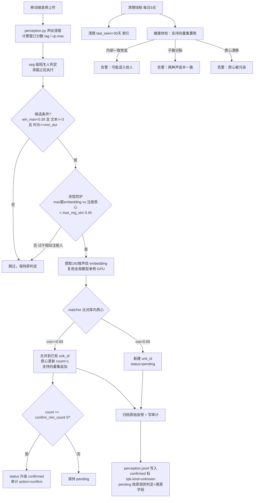

# 陌生人自动识别与溯源功能

> **现状注（2026-10-08）**：陌生人 L1-L4 全链已迁入**闭源音频内核**（轨道 K/A4-B5，Wave C1 收口）。实现位置 = `kernel/axeuh_kernel/unknown/`（segmenter/session/profile/matcher/storage/health/service/config 同名模块），链状态真源 = **内核 state-dir `{state}/unknown/`**（五文件固定布局）。外层仅保留：`unknown_speaker.enabled` 主开关、`lifecycle.*`（每日清理为调度器内建任务 `builtin_unknown_speaker_cleanup`，回调转内核 `POST /v1/unknown/cleanup`）、`two_step.window_ms/hop_ms`（preview 显示用）、`backend/services/unknown_speaker_config.py`（legacy 配置读）。算法语义不变，阈值以内核内置默认（=生产值，逐键差异见 `kernel/axeuh_kernel/unknown/config.py` docstring）与请求级 `config_override` 为准。**音频归档内核不做、外层无活写者**（`audio_archive.*`/`ai/data/cache/unknown_*` 均为历史存量）；下文旧外层模块路径、验证脚本与配置节按此判读。

## 一、任务背景与目标

### 背景
现有健康监护系统的声纹模块（`VoiceprintService`，基于 FunASR ERes2NetV2 的 192 维 embedding + AS-Norm 声学场景矫正）能识别"我"（已注册用户）。但所有未被识别为注册用户的语音段都被直接丢弃，无法做到：
- 自动发现并聚类"同一个陌生人"
- 在数月后再次听到同一陌生人时认出"又是他"
- 回溯"当时是谁在说话"

### 目标
在不改动现有感知流程、不影响主系统的前提下，新增一个**零侵入的补充功能**：
1. 自动从感知流中筛选高质量的陌生人语音段
2. 基于声纹相似度做增量聚类，给同一陌生人分配稳定身份 `unk_id`
3. 即时保存原始音频，便于事后溯源回听
4. 写入不可变审计日志，清晰记录每一次"识别/合并/注册/升级/清理"
5. 生命周期管理：新陌生人先 pending 观察，累计 ≥5 段稳定出现才升级为 confirmed 人物
6. 长期维护：支持向量集 + 每日健康体检，防止质心漂移/串扰
7. 完全可配置开关、可清理、可溯源

## 二、架构总览

### 2.1 模块划分

> **现状注**：下图为外层实现时期的模块图（历史）。现行实现位置与调用面见文首现状注与 §2.2 现状注：外层 `services/unknown_speaker_*` 已删除（仅 `unknown_speaker_config.py` 留存），对应内核 `axeuh_kernel/unknown/` 模块 + `/v1/unknown/*` 端点。

```
感知流水线（routers/perception.py）
   ├─【新链路·默认启用】四层门控 new_chain_enabled()（enabled + session + pyannote 全开）
   │    └─ services/unknown_speaker_session_feed.py  feed_audio_file()
   │         ├─ services/pyannote_segmenter.py       L1 pyannote 切块 + 文件内归并
   │         ├─ services/unknown_speaker_session.py  L2 会话层滚动质心
   │         └─ services/unknown_speaker_profile.py  L3 会话级匹配/开档
   │              └─ services/unknown_speaker_storage.py 持久化（索引/审计/音频归档）
   └─【旧链路·flag 关闭时】seg 级单块直配
        ├─ services/unknown_speaker_matcher.py  增量聚类（merge/create + pending/confirmed + 支持向量集）
        ├─ services/unknown_speaker_storage.py  持久化
        └─ services/unknown_speaker_pipeline.py 聚合 entry：confirmed 才写 entry.unk 摘要

后台线程（main.py lifespan）
   ├─ services/unknown_speaker_cleaner.py  每日清理（TTL）
   │    └─ services/unknown_speaker_health.py 支持向量集重聚，检测串扰/漂移/子簇分裂/簇间融合
   └─ services/pyannote_segmenter.preload_pyannote_segmenter() 启动后台预加载（约 112s）
```

### 2.2 文件清单（backend/ 下，共 10 个服务模块 + 2 个脚本）

> **现状注**：下表为外层实现时期的清单（历史记录）。除 `services/unknown_speaker_config.py`（保留作 legacy 配置读）外，全部模块已迁入内核同名包 `kernel/axeuh_kernel/unknown/`（matcher/storage/health→同名文件，L1-L3→`segmenter.py/session.py/profile.py`，session_feed 串接职责并入内核 `service.py` 的 `/v1/unknown/track`，cleaner 职责→内核 `POST /v1/unknown/cleanup`）；两个脚本（`verify_unknown_speaker.py`/`archive_legacy_unknown_db.py`）**已删除**。

| 文件 | 职责 |
|---|---|
| `services/unknown_speaker_config.py` | 配置加载。内置完整默认配置（fail-safe 默认关闭），本地 `config.yaml` 的 `unknown_speaker` 段作为覆盖 |
| `services/unknown_speaker_matcher.py` | 增量聚类（旧链路）。对新 embedding 与库内所有 `unk_id` 质心比对，`>=merge_threshold(0.65)` 合并，否则新建。管理 status（pending/confirmed）与支持向量集 |
| `services/unknown_speaker_storage.py` | 持久化。索引库 `unknown_speakers.jsonl`、审计 `unknown_audit.jsonl`（不可变）、扫描状态、原始音频归档（含限流） |
| `services/unknown_speaker_pipeline.py` | 聚合层（旧链路）。汇总 entry 内各 seg 的陌生人判定，confirmed 才写 entry 级 unk 摘要并归档音频 |
| `services/unknown_speaker_cleaner.py` | 清理器。每日定时移除超 TTL(30天) 的索引条目（音频与审计永久保留），并触发健康体检 |
| `services/unknown_speaker_health.py` | 健康体检。基于支持向量集检测内部一致性/子簇分裂/质心漂移/簇间融合 |
| `services/pyannote_segmenter.py` | 【L1】pyannote diarization-3.1 收割 + 文件内 SPEAKER 归并 + 块级过滤 |
| `services/unknown_speaker_session.py` | 【L2】会话层。活跃轨道滚动质心、滚入/新轨决策、会话产出与持久化 |
| `services/unknown_speaker_profile.py` | 【L3】档案层。会话级 `match_session`、候选会话池、攒 N 会话开档、相对显著性灰区判定 |
| `services/unknown_speaker_session_feed.py` | 新链路串接。文件级喂送（pyannote→L2→L3）+ 会话音频归档，`new_chain_enabled()` 门控 |
| `scripts/verify_unknown_speaker.py` | 离线验证脚本。不接入线上，验证 import/配置/过滤统计/matcher 逻辑 |
| `scripts/archive_legacy_unknown_db.py` | 旧库封存脚本（备份 `unknown_speakers.jsonl` 为 `legacy_<date>`） |

### 2.3 修改文件
- `backend/routers/perception.py`：新链路门控 `_new_chain`（调用 `feed_audio_file`）；旧链路 seg 级判定、余弦防护、`spk`/`vp.ws_spk` 写入与 entry.unk 摘要（现状：`_new_chain`/`feed_audio_file` 已不在 perception.py；陌生人链 B2 整链切内核，`audio_analysis_pipeline` 经 `POST /v1/unknown/track` 文件级一次产出 facts，外层仅组装 `seg.spk`/entry.unk 落盘）
- `backend/services/voiceprint_service.py`：enroll 改造（VAD 切分 + 逐段 SNR 过滤 + SNR 加权聚合 + 段间一致性过滤）；L4 多锚点（`_centroids` 升级为 `name -> [锚点...]`，`enroll` 支持 `scene_tag`）（现状：该类已迁内核，enroll 走 `/v1/voiceprint/enroll`）
- `backend/main.py`：lifespan 启动清理 daemon 线程 + pyannote 后台预加载（现状：清理改调度器内建任务转内核 `POST /v1/unknown/cleanup`，预加载归内核）
- `config.yaml`（项目根目录）：新增 `unknown_speaker:`（含 `pyannote/session/profile` 段）与 `voiceprint.min_seg_snr/min_consistency` 配置。**注意：该文件被 `.gitignore` 忽略（`/config.yaml`），未进版本库；代码已内联默认值（fail-safe 默认关闭）。**

## 三、业务逻辑（端到端）

### 3.1 流程图



### 3.2 两步切分候选提取（`routers/perception.py`，根治整段混合）
**第1步 VAD 粗切**：音频先按 VAD 切分为有声子段（已有 `vad_segments`）。

**第2步 sim 高分区域提取**：每个 VAD 子段内用 `score_all_v2` 滑窗（**1500ms/750ms**，实测最优）打分：
- 连续高分区（`score > user_score_threshold`，当前 config 为 **0.99**，代码默认 0.5）→ **用户本人区域，剔除**（不进陌生人库）
- 中低分区（`score < 0.5`）→ **陌生人候选区域**，提取独立 embedding 建档
- 每个候选区域 = 单一说话人的连续话语区（**无混合**，解决"一段 60s 混多人"问题）
- 区域最短 `min_seg_sec(1.0s)`，间隙 < `merge_gap_sec(1.0s)` 的相邻区域合并

**用户判定用 score_all_v2（AS-Norm tanh）而非原始余弦**：实测用户子段 score 0.94-0.99（原始余弦仅 0.31-0.60），区分间隙巨大。

### 3.2b 环境感知（10s 滑窗多人判定）
- 统计当前音频内所有滑窗分数的"中间档占比"（`mid_low=0.3 ~ mid_high=0.7`）
- 中间档占比 > `multi_threshold`（当前 config **0.25**，代码默认 0.2）→ **多人环境**（宿舍等）→ `env_mode=multi`
- 单人环境 `env_mode=single`
- 判定结果写入每条 unk 的 `env_stats`（speaker_count_est / env_mode / mid_ratio / sample_conf）

### 3.3 匹配与合并（`matcher.match_or_create`）
1. 若 embedding 无效（None）-> 跳过，不创建条目。
2. 加载 `unknown_speakers.jsonl`（若为空 -> 直接新建）。
3. 对库中每个 `unk_id` 质心计算余弦相似度，取最佳。
4. **两重合并确认**：
   - **第一重（质心）**：最佳余弦 `>= 0.65` -> 合并。
   - **第二重（支持向量集比例判定）**：质心 <0.65 时，新 embedding 与最佳簇的已有向量集两两余弦 `>=0.5` 的占比 `>50%` -> 仍合并（同一人短句 embedding 漂移 0.55-0.65 场景）。
   - 合并：质心更新为加权平均后 L2 归一化；`count+1`；支持向量集追加（归一化后存储，保留最近 `support_vectors_max(50)` 个）；更新 `last_seen`；审计 `action=merge`。
   - 两重都失败 -> 新建：`unk_id = unk_{日期}_{h:04d}_{ts:06d}`；`count=1`；`status=pending`；`support_vectors=[emb]`；`env_stats` 记录环境；审计 `action=create`。
5. **pending 升级（动态 confirm）**：合并后若 `status=pending` 且 `count >= confirm_min`，升级为 `confirmed`，审计 `action=confirm`。`confirm_min` 动态：单人环境 5 段 / 多人环境 8 段（建档照常，pending 更久）。
6. 无论合并或新建，随后执行音频归档（两步切分模式下归档**子段音频**）。

### 3.4 生命周期（pending / confirmed）
- **pending**（新建起，count < confirm_min）：**对外 `seg.spk` 按原规则判定**（registered/mixed/env），但附带 `unk_id/unk_status/unk_count` 溯源字段；**不写 entry 级 `unk` 摘要**（agent 感知不到）。
- **confirmed**（count >= confirm_min）：`seg.spk.kind = unknown`，并写 entry 级 `unk` 摘要（`{id, count, seg_count, score}`），agent 能感知"这个人在场"。

> 新链路（L2/L3）下单块不再建档、`voiceprint_unk` 不再写入 seg；pending/confirmed 由档案层 `session_count` 与会话内部一致性共同决定，语义见《四层架构》文档。旧链路（flag 关闭）仍走 matcher 的 `voiceprint_unk`。

### 3.5 音频归档（`storage.archive_audio`）

> **现状注**：内核**不做子段音频归档**（`audio_archive.*` 语义"内容归内核、位置归外层"未落地为内核功能，外层也无活写者）。`ai/data/cache/unknown_audio/` 为历史存量（只读回听仍可用），现行链不再新增归档文件；条目内 `audio_files` 字段同理仅剩存量。

- 两步切分模式（`segment_archive=true`）下归档**子段音频**（实际说话片段 0.3-5s），而非 60s 整段。
- 归档到 `ai/data/cache/unknown_audio/<unk_id>/<时间戳>.wav`，同目录生成 `<时间戳>.json` 元数据（audio_path、scene、device_name、seg_start、seg_dur、env_mode 等）。
- 限流：同一 `unk_id` 5 分钟内最多归档 3 段，防刷。
- pending 阶段同样归档（升级后自动可用）。
- 关闭 `segment_archive` 时回退归档整段（pipeline 处理）。

### 3.6 审计（`storage.append_audit`）
每次动作追加一行 JSON 到 `unknown_audit.jsonl`，绝不修改/删除历史：
- `action=create` / `action=merge` / `action=confirm` / `action=audio_archived` / `action=cleanup` / `action=health_*`（体检告警）

### 3.7 健康体检（`unknown_speaker_health.check_once`）
基于每条 unk 的 `support_vectors`（最近 N 个段 embedding），每类问题一条告警（写审计）：
1. **内部一致性低**：向量集平均两两余弦 < 0.55 → 可能混入其它说话人
2. **子簇分裂**：向量集能分裂成两个稳定子簇（每组 ≥3 且组间距离大）→ 两种声音被并成一簇，可人工拆分
3. **质心漂移**：最近 5 个向量内部一致（≥0.85，说明是同一人）但与质心余弦 < 0.60 → 质心被早期异常段污染，可用最近向量重建
4. **簇间融合（自动合并）**：库内任意两个 unk 的支持向量集两两余弦 ≥0.5 的占比 >50% → 同一说话人被拆成碎片簇，**自动合并**（质心加权、向量集合并、status 取 confirmed 优先）。这是解决"同一人被拆成多簇"的核心机制（实测：试点 51 段音频的 21 个 confirmed 碎片 → 1 个 236 段大人物）。

### 3.8 清理（`cleaner.cleanup_once`）

> **现状注**：清理已入内核（`POST /v1/unknown/cleanup`）。外层每日调度为统一调度器内建任务 `builtin_unknown_speaker_cleanup`（V13 收编原散装 asyncio 循环），照 `unknown_speaker.enabled` + `lifecycle.cleanup_hour` 门控后回调内核执行。

- 移除 `last_seen` 距今超过 `ttl_days`(30) 的 `unk_id` 索引条目。
- 超额保护：若超 `max_unknown_count`(200)，按最旧优先清理。
- 仅清索引；音频与审计日志永久保留。
- 每日 `cleanup_hour`(3) 执行一次，同线程执行健康体检。

## 四、声纹注册（enroll）改造

> **现状注**：本节机制现由内核 `/v1/voiceprint/enroll` 承担（`voiceprint_service.py` 外层实现已删除；质量门为内核内置常量 `ENROLL_MIN_SNR=15.0`/`ENROLL_MIN_SEG_SNR=1.0`/`ENROLL_MIN_CONSISTENCY=0.55`/`ENROLL_MIN_SPEECH_RATIO=0.5`/`ENROLL_MIN_DURATION=3.0`，外层 `voiceprint.*` 配置键已不再被读）。

`voiceprint_service.py` 的 `enroll` 已从"整段提取单个 embedding"改为：
1. **VAD 切分**：长音频（如 60s）切成多个语音段
2. **逐段提取 + 逐段 SNR**：每段单独提 embedding 并计算 SNR
3. **SNR 过滤**：段 SNR < `VOICEPRINT_MIN_SEG_SNR`(1.0) 丢弃（容忍低音量录音）
4. **段间一致性过滤**：段数 ≥3 时互算余弦，与其它段平均余弦 < `VOICEPRINT_MIN_CONSISTENCY`(0.55) 的段（混入的他人声音/噪音）剔除；过滤后不足 2 段则回退保留全部
5. **聚合质心**：合格段 L2 归一化后按 SNR 加权平均
6. **质量判定**：合格段数 ≥ 2 即通过

## 五、如何验证

> **现状注**：5.1/5.2 引用的外层脚本与模块（`scripts/verify_unknown_speaker.py`、`services/unknown_speaker_*.py`）已删除，命令仅作历史记录。现行验证：内核侧测试 `kernel/tests/`（unknown 链契约与移植回归）；线上验证改看后端 `UnknownSpeaker`/内核日志与 vaudit 审计台。

### 5.1 离线验证（推荐，不接入线上）【历史：脚本已删除】
在 `backend/` 目录下运行：
```bash
python scripts/verify_unknown_speaker.py
```
验证：模块导入、配置加载、过滤逻辑统计、matcher create/merge/pending 逻辑（使用临时文件，不污染真实数据）。

### 5.2 语法检查
```bash
python -m py_compile main.py services/unknown_speaker_*.py scripts/verify_unknown_speaker.py
```

### 5.3 线上验证（启用后）
1. 确认 `config.yaml` 的 `unknown_speaker.enabled: true`（当前已设；主开关仍归外层）。
2. 重启后端服务（后端按需拉起内核）。
3. 观察日志：内核不可达/链失败时 `audio_analysis_pipeline` 按 requeue 降级重投并记日志；陌生人判定随 voice 条目的 `spk`/`unk` 字段落 `perception.jsonl`，建档与审计经 vaudit 审计台（内核 `/v1/unknown/*`）查看。原"清理线程已启动"日志随外层 daemon 删除已成历史，清理改由调度器内建任务回调内核（见 §3.8 现状注）。
4. 检测随每条音频上传实时发生（文件级一次经 `POST /v1/unknown/track`）。

## 六、如何查看程序运行结果

> **现状注**：链五文件真源 = 内核 state-dir `{state}/unknown/`（生产现址 `backend/data/kernel_state/unknown/`）：`unknown_speakers.jsonl`、`unknown_audit.jsonl`、`unknown_pending_sessions.jsonl`、`unknown_session_state.json`、`unknown_scan_state.json`。外层 `ai/data/cache/unknown_*` 为迁移前存量（无活写者）；vaudit 建档页仍按 cache 候选路径读取（镜像残留读面，可能滞后）。权威程序化查询面：内核 `GET /v1/unknown/profiles`、`GET /v1/unknown/state`（经外层 `/api/vaudit/*`）。

### 6.1 索引库 `unknown_speakers.jsonl`
每行一个 `unk_id` 条目：
```json
{
  "unk_id": "unk_20260823_2879_405481",
  "centroid": [0.01, -0.03],
  "count": 25,
  "status": "confirmed",
  "support_vectors": [[0.01, ...], ...],
  "first_seen": "2026-08-23T00:10:00",
  "last_seen": "2026-08-23T08:30:00",
  "audio_files": ["...wav"],
  "scenes": ["说话声"],
  "devices": ["..."]
}
```
用途：查看"哪些陌生人被识别、各出现多少次、是否已确认（confirmed）"。

### 6.2 感知数据（perception.jsonl）
- confirmed 段：`seg.spk.kind = "unknown"`，含 unk_id/count/is_new；entry 级含 `unk` 摘要
- pending 段：`seg.spk` 保留原判定，附 `unk_id/unk_status/unk_count` 溯源字段
- 窗口身份序列：`vp.ws_spk` 数组（每窗口的 speaker 标记，含 unk_id）

### 6.3 审计日志 `unknown_audit.jsonl`（不可变）
每一行是一次动作记录：create / merge / confirm / audio_archived / cleanup / health_*。

### 6.4 音频归档 `unknown_audio/<unk_id>/`

> **现状注**：现行链不再归档（见 §3.5 现状注），本目录为历史存量，只读回听。

- `<时间戳>.wav`：原始音频片段
- `<时间戳>.json`：该段的元数据
用途：直接回听，确认"这个陌生人是谁、说了什么"，实现溯源。

## 七、配置说明

> **现状注**：下表是**外层实现时期**的 `config.yaml unknown_speaker` 生产值快照。内核迁移后（A4/B 系列）：外层实际只消费 `enabled` 主开关、`lifecycle.*`（`cleanup_hour` 定外层调度时点，整节随 config_override 传内核）、`detection.two_step.window_ms/hop_ms`（preview 显示对齐）；其余算法键**不再被外层读取**，内核内置默认 = 本表生产值（逐键差异登记在 `kernel/axeuh_kernel/unknown/config.py` docstring），请求级 `config_override` 可临时覆盖。`storage.*`/`audio_archive.*` 为无活写者的 legacy 键。本表保留作 config_override 兼容结构与调参史参考，现行行为以内核代码与 `docs/kernel-contract.md` 为准。

本地项目根目录的 `config.yaml` 的 `unknown_speaker` 小节（被 `.gitignore` 忽略，未进版本库）。下列为**当时生效值**，括号内标注与代码内置默认值（`services/unknown_speaker_config.py`，已随迁移退役）的差异：

```yaml
unknown_speaker:
  enabled: true                 # 代码默认 false（fail-safe）
  detection:
    max_vp_score: 0.3           # 候选区窗口最高分上限
    max_reg_sim: 0.99           # 余弦防护上界（代码默认 0.45）
    min_tokens: 3
    min_duration_sec: 2.5       # 代码默认 1.5
    min_snr: 0.0
    two_step:
      enabled: true
      window_ms: 1500
      hop_ms: 750
      user_score_threshold: 0.99  # AS-Norm 用户判定线（代码默认 0.5）
      min_seg_sec: 1.0
      merge_gap_sec: 1.0
      user_gap_max_sec: 0         # 代码默认 2.5
    env_estimation:
      enabled: true
      window_sec: 10.0
      mid_low: 0.3
      mid_high: 0.7
      multi_threshold: 0.25       # 代码默认 0.2
  matching:
    merge_threshold: 0.65
    centroid_method: weighted_avg
    sv_ratio_match:
      enabled: true
      ratio_threshold: 0.55       # 两两余弦阈值（代码默认 0.55）
      min_frac: 0.5               # 达标对占比阈值
      min_vectors: 5              # 至少几个向量才启用（代码默认 5）
  lifecycle:
    ttl_days: 30
    cleanup_hour: 3
    max_unknown_count: 200
    confirm_min_count: 8          # 代码默认 5；实际由 dynamic_confirm 决定
    support_vectors_max: 50
    dynamic_confirm:
      enabled: true
      single_confirm_min_count: 5
      multi_confirm_min_count: 8
  audio_archive:
    enabled: true
    root: ai/data/cache/unknown_audio
    segment_archive: true
    min_duration_sec: 1.0
  pyannote:                       # L1（代码默认 enabled: false）
    enabled: true
    model: pyannote/speaker-diarization-3.1
    min_seg_sec: 0.5
    file_merge_threshold: 0.55
    preload_on_start: true
  session:                        # L2（代码默认 enabled: false）
    enabled: true
    block_min_sec: 3.0
    speech_ratio_min: 0.0         # 2026-09-08 停用（低语音占比文件放行）
    merge_threshold: 0.6
    hard_reject: 0.55
    session_gap_sec: 60.0
    rolling_window: 12
    min_blocks_per_session: 3
    cold_start_blocks: 3
    flush_idle_sec: 90.0
    persist_every_blocks: 10
  profile:                        # L3（代码默认 enabled: false）
    enabled: true
    open_threshold: 0.6
    open_threshold_strong: 0.8
    margin_min: 0.08
    open_min_sessions: 3
    multi_open_min_sessions: 5
    internal_min_sim: 0.55
    internal_confirm_sim: 0.75
    pending_ttl_hours: 24
    pending_max: 200
    pending_reverse_merge: 0.85
  storage:
    unknown_db: ai/data/cache/unknown_speakers.jsonl
    audit_log: ai/data/cache/unknown_audit.jsonl
    scan_state: ai/data/cache/unknown_scan_state.json
    pending_db: ai/data/cache/unknown_pending_sessions.jsonl
    session_state: ai/data/cache/unknown_session_state.json
```

`voiceprint` 小节相关：

```yaml
voiceprint:
  min_snr: 15.0
  min_seg_snr: 1.0
  min_consistency: 0.55
```

代码内置默认值 `enabled: false`（fail-safe）；本地 `config.yaml` 缺失该小节时功能完全关闭，不影响主系统。上文 `max_reg_sim`、`user_score_threshold` 等已在本地调优，与代码默认不同。

## 八、注意事项与待校准

1. **阈值需实际校准**：`max_vp_score=0.30`、`merge_threshold=0.65`、`max_reg_sim=0.99`（本地调优值）、体检阈值（一致性 0.55/漂移 0.60/子簇 0.60）基于合成测试与真实数据估算，无完整 ground truth。建议启用后观察 `unknown_audit.jsonl` 与体检告警数天再微调。
2. **已发现的真实数据问题**：体检在真实聚类上发现 2 个疑似混簇（#3821 [11,5,4]、#8705 粤语 [3,3]），待人工核查拆分。
3. **磁盘占用**：`unknown_audio/` 音频永久保留（溯源诉求），TTL 只清索引。（现状：内核链不再归档新音频，此目录为历史存量，见 §3.5 现状注。）
4. **配置不进版本库**：`config.yaml` 被 `.gitignore` 忽略，部署到新机器需手动添加配置段。
5. **老数据无 support_vectors**：功能上线前已存在的 unk 条目无向量集，体检会跳过（不影响使用，新数据自动累积）。
6. **可关闭**：`enabled=false` 或删除配置小节即完全停用。

## 九、提交记录
- 备份分支：`backup-before-unknown-speaker-20260822-224344`（commit `593b51d7`）
- 功能提交：master commit `ee1d6beb` "feat: 陌生人自动识别与溯源补充功能"
- 重构提交：master commit `a5242682` "refactor: 陌生人识别改为音频流水线内实时检测，移除文件监听扫描器"
- 2026-08-23 维护机制：seg 级判定 + pending/confirmed + 支持向量集 + 健康体检 + enroll 一致性过滤 + max_reg_sim 余弦防护（本会话）
- 2026-08-25 移除场景过滤：任何场景下满足阈值即建档（commit 待补）
- 2026-09-01 两步切分 + 动态多人感知：commit `6c6ceb79`（两步切分、动态 confirm 5/8、env_stats、归一化向量集、子段归档、清库重建）
- 2026-09-01 支持向量集比例判定 + 簇间融合：commit 待补（matcher 第二重合并确认 + 体检自动合并碎片簇）
- 2026-09-05 四层架构落地：`pyannote_segmenter.py`（L1）+ `unknown_speaker_session.py`（L2）+ `unknown_speaker_profile.py`（L3）+ `unknown_speaker_session_feed.py` 串接；perception.py 加 `_new_chain` 门控
- 2026-09-08 `session.speech_ratio_min` 门槛停用（低语音占比文件放行进切块）；详见《四层架构落地实现设计》与《声纹审计平台 vaudit》
